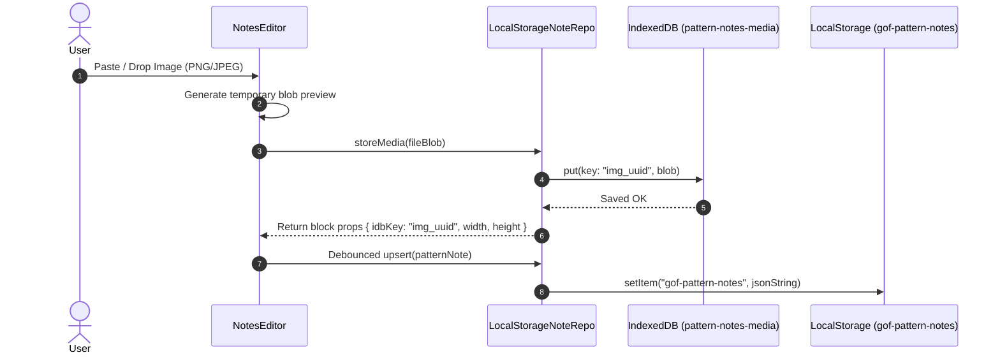

# Architectural Decision Record (ADR): Per-Pattern Rich Notes Architecture

**Document ID:** ADR-2026-003  
**Status:** Accepted  
**Date:** 2026-10-12  
**Context Reference:** [PRD-2026-003-v2 (Per-Pattern Rich Notes)](../prds/prd-per-pattern-notes.md)  
**Author:** Antigravity Engineering Agent  

---

## 1. Executive Summary

This record captures the core architectural, storage, layout, and contract decisions for the **Per-Pattern Rich Notes System** in the GoF Design Patterns Masterclass monorepo. It establishes a database-agnostic repository layer, dual-orientation non-modal UI split panes, hybrid client-side media storage transitioning to PostgreSQL JSONB with Backblaze B2 object storage, and strict zero-3rd-nested-scroll constraints.

```mermaid
graph TD
    UI[PatternDetailPage / NotesWorkspacePage] --> Context[NoteRepositoryContext]
    Context --> RepoIF[<<interface>> NoteRepository]
    RepoIF --> LocalRepo[LocalStorageNoteRepository (Phase 1)]
    RepoIF -.-> ApiRepo[ApiNoteRepository (Phase 2 Server)]
    
    LocalRepo --> LS[(Browser LocalStorage - AST)]
    LocalRepo --> IDB[(IndexedDB - Image Blobs)]
    
    ApiRepo --> Backend[Express 5 /api/patterns/:id/notes]
    Backend --> PG[(PostgreSQL + JSONB - Drizzle ORM)]
    Backend --> B2[(Backblaze B2 - S3 API Image Store)]
```

---

## 2. ADR-001: DB-Agnostic NoteRepository Pattern

### Context
The application is pre-launch with no live user base. It currently executes client-side with mock progress persistence in browser `localStorage`. However, the product roadmap mandates full multi-tenant per-user persistence via PostgreSQL and authenticated cloud sync. Coupling UI components directly to `localStorage` would cause massive regression and refactoring debt when backend APIs are activated.

### Decision
Implement the **Repository Pattern** (`NoteRepository`) behind a React Context provider (`NoteRepositoryContext`):

```typescript
export interface NoteRepository {
  get(patternId: string): Promise<PatternNote | null>;
  upsert(note: PatternNote): Promise<void>;
  getAll(): Promise<PatternNote[]>;
  delete(patternId: string): Promise<void>;
}
```

* **Client Implementation (Immediate)**: `LocalStorageNoteRepository` satisfies this interface using local storage for note metadata/AST and IndexedDB for binary assets.
* **Server Implementation (Cloud Sync)**: `ApiNoteRepository` satisfies this identical interface by calling the typed endpoints generated from `lib/api-spec/openapi.yaml`.
* **Component Decoupling**: React components (`PatternNotesPanel`, `NotesWorkspacePage`, `NotesEditor`) consume `useNoteRepository()` and remain 100% agnostic of whether data is stored in the browser, SQLite, PostgreSQL, or a cloud API.

### Alternatives Considered
1. **Direct Zustand Store with `persist` middleware**:
   * *Rejected*: Zustand persistence tightly couples state shape to storage keys and synchronous serialisation, making async database calls, conflict resolution, and offline sync difficult to isolate.
2. **Ad-hoc React Query hooks fetching `/api` directly**:
   * *Rejected*: Requires backend services and active database connections immediately, blocking local offline usage and standalone static previews.

### Consequences
* **Positive**: Swapping from offline storage to authenticated cloud database requires changing a single line in `App.tsx` (`<NoteRepositoryContext.Provider value={...}>`).
* **Positive**: Fully testable via in-memory mock repositories without mocking browser globals.
* **Negative**: Introduces an asynchronous contract (`Promise<PatternNote>`) for local operations, requiring React state machines to handle `loading` and `saving` states even when reading from fast local storage.

---

## 3. ADR-002: Dual-Orientation Panel System (Horizontal Default vs Vertical Stacked)

### Context
Users study GoF design patterns in diverse screen environments (laptops, ultra-wide desktop monitors, vertical code displays, and tablets). Modal dialogs with dark overlays obscure the pattern's source code and structural diagrams while writing notes. A fixed side drawer cramps code width on 13-inch displays.

### Decision
Utilize `react-resizable-panels` to provide a **non-modal split layout** embedded directly inside `PatternDetailPage`:
1. **Default Mode (Horizontal Split)**: Content pane (65% width) on the left, Notes editor (35% width) on the right.
2. **Alternative Mode (Vertical Split / Bottom Shelf)**: Content pane (60% height) on top, Notes editor (40% height) on the bottom.
3. **Toggle Control**:
   * Button in navigation bar (`[⊟]` / `[⊞]`).
   * Global keyboard shortcut `Shift+N` (when outside text inputs).
   * Separate ratio memory: `autoSaveId="notes-panel-h"` and `autoSaveId="notes-panel-v"`.
4. **Orientation Transition**:
   * Dynamically toggles `PanelGroup direction="horizontal" | "vertical"`.
   * Container wrapped with Framer Motion `layout` to provide smooth morphing without unmounting the editor DOM.

```
HORIZONTAL (Default):                    VERTICAL (Toggled Shelf):
┌───────────────────┬──────────────┐    ┌──────────────────────────────────┐
│ Content Pane      │ Notes Pane   │    │ Content Pane                     │
│ (scroll #1)       │ (scroll #2)  │    │ (scroll #1)                      │
│                   │              │    ├══════════════════════════════════┤
│                   │              │    │ Notes Pane (scroll #2)           │
└───────────────────┴──────────────┘    └──────────────────────────────────┘
```

### Alternatives Considered
1. **Fixed Drawer Overlay (`NotesDrawer.tsx`)**:
   * *Rejected*: Dark backdrop overlay prevents simultaneous reading and editing; violates core requirement.
2. **Floating Draggable Window**:
   * *Rejected*: Covers arbitrary sections of diagrams and code; high window management friction on smaller screens.
3. **Dedicated Tab in Pattern Detail ("Notes" tab alongside Overview, Code, Diagrams)**:
   * *Rejected*: Destroys the primary learning workflow of taking notes *while* examining code or reading intent.

### Consequences
* **Positive**: Zero occlusion of reference material. Full customization of layout geometry.
* **Negative**: Requires strict flexbox container heights (`h-full min-h-0`) to prevent parent containers from expanding beyond the viewport.

---

## 4. ADR-003: Hybrid Storage — LocalStorage/IndexedDB to PostgreSQL JSONB + Backblaze B2

### Context
Notes contain two distinct data types:
1. **Structured AST & Metadata**: Lightweight text blocks, headings, tags, code snippets, timestamps (< 50 KB per note).
2. **Binary Media**: Architectural diagrams, whiteboard captures, screenshots (100 KB – 5 MB per image).

Storing raw binary base64 strings directly in browser `localStorage` or PostgreSQL database rows causes massive table bloat, degrades query throughput, and rapidly exhausts browser quotas (5–10 MB total limit).

### Decision
Adopt a **two-tier hybrid storage strategy** across client and cloud lifecycles:

#### Client-Side (Offline / Phase 1)
* **Metadata & AST**: Stored in `localStorage` under `gof-pattern-notes:v1` as serialized JSON.
* **Image Blobs**: Stored in browser **IndexedDB** (`pattern-notes-media` database, `images` object store).
* **AST Linkage**: Blocks reference images via unique synthetic keys: `{ idbKey: "img_uuid4_timestamp" }`.
* **Export/Import Portability**: Export functions resolve IndexedDB blobs and inline them as base64 in self-contained `.json` bundles. On import, base64 strings are re-extracted into IndexedDB.

#### Server-Side / Cloud (Phase 2)
* **Metadata & AST**: Stored in **PostgreSQL** table `pattern_notes` using a `jsonb` column for the block tree, indexed with GIN.
* **Database Provider**: **Neon Serverless PostgreSQL** (free tier: 0.5 GB, native Drizzle integration, zero cold-start delay).
* **Media & Object Storage**: **Backblaze B2** (S3-compatible API, 10 GB free tier, zero or ultra-low egress pricing via Cloudflare Bandwidth Alliance, replacing Supabase).
* **Binary Ingestion Flow**: Client requests presigned S3 upload URL from Express backend → uploads directly to Backblaze B2 bucket → saves public/signed URL in the BlockNote AST block props.



### Alternatives Considered
1. **Supabase PostgreSQL + Supabase Storage**:
   * *Rejected per user directive*: User chose Backblaze B2 for S3 compatibility and cost predictability over Supabase vendor-locked APIs.
2. **Storing base64 images directly inside LocalStorage**:
   * *Rejected*: Exceeds 5MB quota after 2-3 high-resolution architecture diagrams.
3. **MongoDB / Document Store**:
   * *Rejected*: Monorepo already standardizes on PostgreSQL with Drizzle ORM (`lib/db`). Adding MongoDB creates unnecessary dual-database operational overhead.

### Consequences
* **Positive**: High storage capacity locally (hundreds of MBs in IndexedDB). Zero database bloat when transitioning to PostgreSQL. Standard S3 SDK integration for Backblaze B2.
* **Negative**: Requires asynchronous blob-to-URL hydration when rendering images from IndexedDB.

---

## 5. ADR-004: BlockNote Rich Text Block Tree Architecture

### Context
The user requires rich formatting: headings, inline marks, code blocks with syntax highlighting, bullet/numbered lists, callouts, and resizable images with slash commands (`/`) and bubble formatting toolbars.

### Decision
Integrate **BlockNote** (`@blocknote/react`, `@blocknote/core`, `@blocknote/mantine`):
* **ProseMirror Foundation**: Mature, battle-tested content-editable engine under the hood.
* **Block-Based AST**: First-class block structure where every paragraph, heading, or image is an independent node with an ID.
* **Clean JSON Serialization**: `editor.document` exports cleanly to standard JSON arrays matching Zod validation schemas.
* **React 19 Lazy Loading**: To prevent initial bundle degradation, the editor component is dynamically imported with `React.lazy()` and Suspense fallback shimmer.

### Alternatives Considered
1. **Raw ProseMirror / Slate**:
   * *Rejected*: Excessive engineering overhead to build Notion-like UI, drag handles, and slash command popups.
2. **TipTap**:
   * *Rejected*: Good, but requires styling and wiring every floating menu and block drag handle manually.
3. **Monaco Editor / Plain Markdown**:
   * *Rejected*: Fails requirement for WYSIWYG inline images, corner resizing, and rich visual interactive notes.

### Consequences
* **Positive**: Modern, professional Notion-style editing experience out of the box. Clean schema validation.
* **Negative**: Adds ~180KB to deferred chunk size (mitigated by lazy loading on note panel open).

---

## 6. ADR-005: Zero 3rd Nested Scroll Guarantee

### Context
A primary UX failure in nested web layouts is "scroll trapping" or "scroll inception", where mousewheel events trigger inner container scrolling unpredictably across 3 or more levels.

### Decision
Enforce a hard mathematical limit of **at most 2 scroll levels** throughout the design:

```
[Level 1: Page Frame (h-screen, overflow-hidden)]
       │
       ├─── [Level 2A: Content Scroll Container (overflow-y: auto)]
       │         └── Static flowing DOM elements (no internal scroll)
       │
       └─── [Level 2B: Notes Scroll Container (overflow-y: auto)]
                 └── Editor Block tree (auto-growing, no inner scroll)
```

1. **Outer Viewport**: Fixed height (`100vh`), root `body` overflow locked.
2. **Sibling Panes**: Both content pane and notes panel have `overflow-y: auto` and `overscroll-behavior: contain`.
3. **Editor Elements**: Code blocks, block quotes, and images use `overflow: visible` with wrapping or max-width constraints. Never set `overflow-y: auto` inside the editor blocks.

### Consequences
* **Positive**: Completely predictable trackpad and wheel scrolling behavior. Zero trapped scrollbars.
* **Negative**: Long code snippets in notes will wrap or require horizontal scrolling rather than vertical boxing.

---

## 7. Architectural Decisions Summary Matrix

| ID | Domain | Chosen Solution | Status |
| :--- | :--- | :--- | :--- |
| **ADR-001** | Abstraction | `NoteRepository` Interface + React Context | **Accepted** |
| **ADR-002** | UI Layout | `react-resizable-panels` Dual-Orientation (H ↔ V) | **Accepted** |
| **ADR-003** | Local Storage | LocalStorage (AST) + IndexedDB (Blobs) | **Accepted** |
| **ADR-004** | Cloud Storage | PostgreSQL JSONB (Neon) + Backblaze B2 (S3 API) | **Accepted** |
| **ADR-005** | Editor Engine | BlockNote (`@blocknote/react`) with Lazy Loading | **Accepted** |
| **ADR-006** | Scroll Limits | Max 2 Levels (Frame → Sibling Containers) | **Accepted** |
| **ADR-007** | Autosave | 2000ms Debounce + Save State Machine | **Accepted** |
