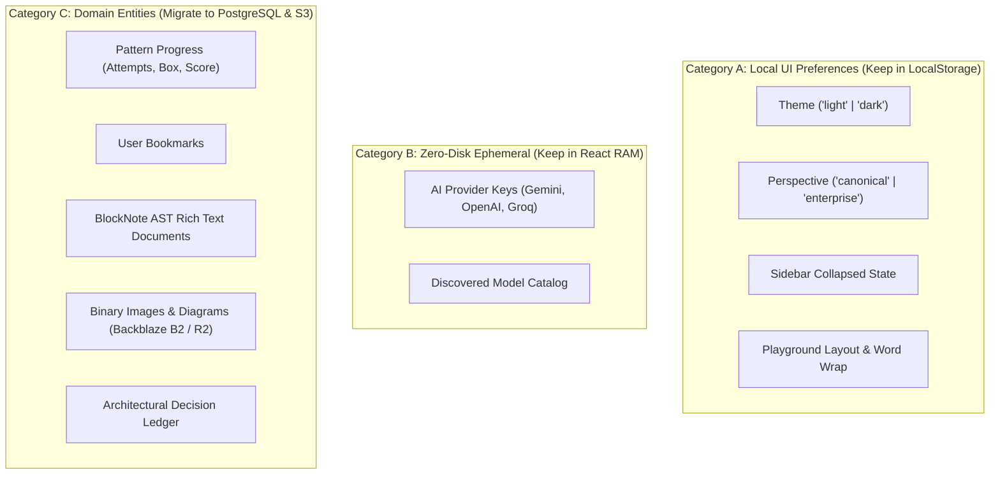
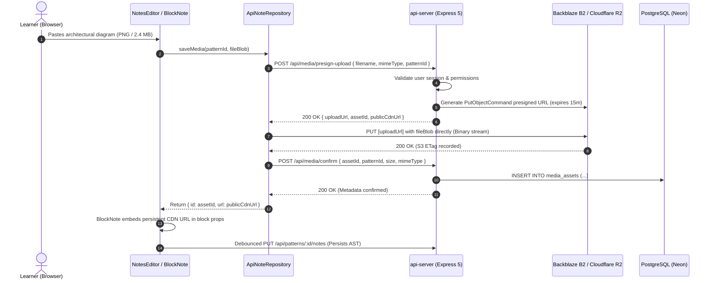

# Architectural Report: Database & Object Storage Migration

**Document ID:** ARCH-2026-004  
**Status:** Proposed / Under Review  
**Date:** 2026-10-13  
**Domain:** Persistence & Storage Infrastructure  
**Author:** Antigravity Engineering Agent  

---

## 1. Executive Summary & Problem Context

The **GoF Design Patterns Masterclass** platform currently relies on client-side storage primitives:
* **Browser `localStorage`**: Holds pattern bookmarks, quiz/spaced-repetition progress (`gof-masterclass-storage`), and rich text AST notes (`gof-pattern-notes:v1`).
* **Browser `IndexedDB`**: Holds binary image assets (`pattern-notes-media`) pasted or dropped into pattern notes.
* **In-Memory React State**: Holds the Architectural Decision Records (ADR) ledger and ephemeral LLM Bring-Your-Own-Key (BYOK) credentials.

While this local-first architecture enabled rapid prototyping and zero server operating costs, it has reached its ceiling:
1. **Zero Cross-Device Portability**: A learner who studies patterns on desktop cannot access their progress, bookmarks, or rich notes on a laptop or mobile tablet.
2. **Data Loss Vulnerability**: Clearing browser cache, private browsing mode, or storage pressure silently evicts local state.
3. **No Collaboration or Analytics**: Impossible to track cohort learning metrics, aggregate common pattern misconceptions, or share architectural decision ledgers.

This document presents a concrete engineering blueprint to migrate all core domain data into **Serverless PostgreSQL (via Drizzle ORM)** and binary media into **S3-compatible Object Storage (Backblaze B2 / Cloudflare R2)**, while adhering to the monorepo's strict contract-first principles, zero-trust RAM security model, and Clean Architecture standards.

---

## 2. Inventory & Classification of Client State

Before modifying code, we classify every piece of application state into three distinct persistence categories:



| State Key | Current Location | Size / Type | Target Destination | Migration Strategy |
| :--- | :--- | :--- | :--- | :--- |
| `gof-masterclass-storage.progress` | `localStorage` | ~2–10 KB JSON | PostgreSQL `user_progress` table | Auto-sync on login via API |
| `gof-masterclass-storage.bookmarks` | `localStorage` | < 1 KB JSON | PostgreSQL `user_bookmarks` table | Auto-sync on login via API |
| `gof-pattern-notes:v1` | `localStorage` | 10–200 KB JSON | PostgreSQL `pattern_notes` (`jsonb`) | Implement `ApiNoteRepository` |
| `pattern-notes-media` | `IndexedDB` | 1–50 MB Blobs | Backblaze B2 / Cloudflare R2 | Presigned S3 direct upload |
| Session Decision Ledger | React RAM | Dynamic JSON | PostgreSQL `decision_ledger` table | Auto-sync via `/decision-ledger` |
| `theme`, `perspective`, `sidebar` | `localStorage` | String flags | Retain in `localStorage` + optional DB sync | Instant zero-flash client boot |
| AI API Keys (BYOK) | React RAM | Strings in RAM | **STRICTLY RETAIN IN REACT RAM** | Never store in DB or disk |

---

## 3. Object Storage Evaluation: Backblaze B2 vs. Cloudflare R2

The user request references *"object storage backblaze r2"*. In production cloud infrastructure, these are two distinct leading S3-compatible providers:

| Attribute | Backblaze B2 (S3 API) | Cloudflare R2 (S3 API) |
| :--- | :--- | :--- |
| **API Protocol** | 100% AWS S3 v4 Compatible | 100% AWS S3 v4 Compatible |
| **Storage Pricing** | **$0.006 / GB / month** (10 GB free) | **$0.015 / GB / month** (10 GB free) |
| **Egress (Download) Pricing** | **$0.00** via Cloudflare CDN integration ($0.01/GB direct) | **$0.00 permanently** (Zero egress fees anywhere) |
| **Operation Pricing** | Class A (PUT): $0.005 / 10k<br>Class B (GET): $0.0004 / 10k | Class A: $4.50 / 1M (1M/mo free)<br>Class B: $0.36 / 1M (10M/mo free) |
| **Global Edge Latency** | Centralized regional datacenters | Globally distributed edge storage |
| **Node.js SDK** | `@aws-sdk/client-s3` | `@aws-sdk/client-s3` |

### Strategic Recommendation: S3 Client Abstraction
Because both providers implement the standard AWS S3 API (`@aws-sdk/client-s3`), we implement a **provider-agnostic S3 Storage Adapter**. Switching between Backblaze B2 and Cloudflare R2 requires changing only environment variables:

```env
# Backblaze B2 Configuration:
S3_ENDPOINT="https://s3.us-west-004.backblazeb2.com"
S3_REGION="us-west-004"
S3_BUCKET="gof-notes-media-prod"
S3_ACCESS_KEY_ID="004..."
S3_SECRET_ACCESS_KEY="K004..."
S3_PUBLIC_CDN_URL="https://media.gofmasterclass.com"

# OR Cloudflare R2 Configuration:
# S3_ENDPOINT="https://<ACCOUNT_ID>.r2.cloudflarestorage.com"
# S3_REGION="auto"
# S3_BUCKET="gof-notes-media-prod"
# S3_ACCESS_KEY_ID="r2_token_id"
# S3_SECRET_ACCESS_KEY="r2_token_secret"
# S3_PUBLIC_CDN_URL="https://media.gofmasterclass.com"
```

### Switchable Storage Service Implementation (`artifacts/api-server/src/services/storage.service.ts`)

```typescript
import { S3Client, PutObjectCommand, DeleteObjectCommand } from "@aws-sdk/client-s3";
import { getSignedUrl } from "@aws-sdk/s3-request-presigner";

export interface PresignedUploadResult {
  uploadUrl: string;
  assetId: string;
  s3Key: string;
  publicUrl: string;
}

export class S3StorageService {
  private client: S3Client;
  private bucket: string;
  private publicCdnUrl: string;

  constructor() {
    const endpoint = process.env.S3_ENDPOINT;
    const region = process.env.S3_REGION || "auto";
    const accessKeyId = process.env.S3_ACCESS_KEY_ID;
    const secretAccessKey = process.env.S3_SECRET_ACCESS_KEY;
    this.bucket = process.env.S3_BUCKET || "gof-notes-media";
    this.publicCdnUrl = (process.env.S3_PUBLIC_CDN_URL || "").replace(/\/+$/, "");

    if (!endpoint || !accessKeyId || !secretAccessKey) {
      throw new Error("Missing S3 configuration: S3_ENDPOINT, S3_ACCESS_KEY_ID, and S3_SECRET_ACCESS_KEY are required");
    }

    // Single unified client that works seamlessly across Cloudflare R2, Backblaze B2, or AWS S3
    this.client = new S3Client({
      endpoint,
      region,
      credentials: { accessKeyId, secretAccessKey },
    });
  }

  async generatePresignedUploadUrl(
    userId: string,
    patternId: string,
    filename: string,
    mimeType: string
  ): Promise<PresignedUploadResult> {
    const ext = filename.includes(".") ? filename.split(".").pop() : "png";
    const assetId = `asset-${crypto.randomUUID()}`;
    const s3Key = `media/${userId}/${patternId}/${assetId}.${ext}`;

    const command = new PutObjectCommand({
      Bucket: this.bucket,
      Key: s3Key,
      ContentType: mimeType,
    });

    const uploadUrl = await getSignedUrl(this.client, command, { expiresIn: 900 }); // 15-minute expiry
    const publicUrl = this.publicCdnUrl
      ? `${this.publicCdnUrl}/${s3Key}`
      : `${process.env.S3_ENDPOINT}/${this.bucket}/${s3Key}`;

    return { uploadUrl, assetId, s3Key, publicUrl };
  }

  async deleteFile(s3Key: string): Promise<void> {
    await this.client.send(new DeleteObjectCommand({
      Bucket: this.bucket,
      Key: s3Key,
    }));
  }
}

export const storageService = new S3StorageService();
```


---

## 4. Architecture: Presigned S3 Direct Upload Flow

Passing multi-megabyte image binaries directly through the Node.js Express server saturates server memory and compute threads. Instead, we implement the **Presigned Direct Upload Pattern**:



---

## 5. Target PostgreSQL Schema Design (`lib/db`)

In accordance with `.agents/rules/backend.md`, all database tables are declared modularly using Drizzle ORM inside `lib/db/src/schema/`.

### 5.1 `lib/db/src/schema/progress.ts`
```typescript
import { pgTable, serial, text, integer, timestamp, uniqueIndex } from "drizzle-orm/pg-core";
import { usersTable } from "./users";

export const userProgressTable = pgTable("user_progress", {
  id: serial("id").primaryKey(),
  userId: text("user_id").notNull().references(() => usersTable.id, { onDelete: "cascade" }),
  patternId: text("pattern_id").notNull(),
  attempts: integer("attempts").notNull().default(0),
  correct: integer("correct").notNull().default(0),
  box: integer("box").notNull().default(1), // Leitner box 1 to 5
  note: text("note").default(""),
  createdAt: timestamp("created_at", { withTimezone: true }).defaultNow().notNull(),
  updatedAt: timestamp("updated_at", { withTimezone: true }).defaultNow().notNull(),
}, (table) => [
  uniqueIndex("user_pattern_progress_idx").on(table.userId, table.patternId),
]);
```

### 5.2 `lib/db/src/schema/bookmarks.ts`
```typescript
import { pgTable, serial, text, timestamp, uniqueIndex } from "drizzle-orm/pg-core";
import { usersTable } from "./users";

export const userBookmarksTable = pgTable("user_bookmarks", {
  id: serial("id").primaryKey(),
  userId: text("user_id").notNull().references(() => usersTable.id, { onDelete: "cascade" }),
  patternId: text("pattern_id").notNull(),
  createdAt: timestamp("created_at", { withTimezone: true }).defaultNow().notNull(),
}, (table) => [
  uniqueIndex("user_pattern_bookmark_idx").on(table.userId, table.patternId),
]);
```

### 5.3 `lib/db/src/schema/notes.ts`
```typescript
import { pgTable, serial, text, integer, timestamp, jsonb, uniqueIndex } from "drizzle-orm/pg-core";
import { usersTable } from "./users";

export const patternNotesTable = pgTable("pattern_notes", {
  id: serial("id").primaryKey(),
  userId: text("user_id").notNull().references(() => usersTable.id, { onDelete: "cascade" }),
  patternId: text("pattern_id").notNull(),
  blocks: jsonb("blocks").notNull(), // BlockNote AST Document array
  version: integer("version").notNull().default(1),
  createdAt: timestamp("created_at", { withTimezone: true }).defaultNow().notNull(),
  updatedAt: timestamp("updated_at", { withTimezone: true }).defaultNow().notNull(),
}, (table) => [
  uniqueIndex("user_pattern_notes_idx").on(table.userId, table.patternId),
]);
```

### 5.4 `lib/db/src/schema/media.ts`
```typescript
import { pgTable, text, integer, timestamp, serial, index } from "drizzle-orm/pg-core";
import { usersTable } from "./users";

export const mediaAssetsTable = pgTable("media_assets", {
  id: text("id").primaryKey(), // e.g. "asset-uuid4"
  userId: text("user_id").notNull().references(() => usersTable.id, { onDelete: "cascade" }),
  patternId: text("pattern_id").notNull(),
  s3Key: text("s3_key").notNull(),
  mimeType: text("mime_type").notNull(),
  fileSizeBytes: integer("file_size_bytes").notNull(),
  publicUrl: text("public_url").notNull(),
  createdAt: timestamp("created_at", { withTimezone: true }).defaultNow().notNull(),
}, (table) => [
  index("media_user_pattern_idx").on(table.userId, table.patternId),
]);
```

### 5.5 `lib/db/src/schema/decision-ledger.ts`
```typescript
import { pgTable, text, integer, timestamp, serial, index } from "drizzle-orm/pg-core";
import { usersTable } from "./users";

export const decisionLedgerTable = pgTable("decision_ledger", {
  id: serial("id").primaryKey(),
  userId: text("user_id").notNull().references(() => usersTable.id, { onDelete: "cascade" }),
  problemStatement: text("problem_statement").notNull(),
  primaryPattern: text("primary_pattern").notNull(),
  runnerUpPattern: text("runner_up_pattern"),
  confidence: integer("confidence").notNull(),
  tradeOffs: text("trade_offs").array(),
  createdAt: timestamp("created_at", { withTimezone: true }).defaultNow().notNull(),
}, (table) => [
  index("decision_ledger_user_idx").on(table.userId),
]);
```

---

## 6. Contract-First API Updates (`lib/api-spec/openapi.yaml`)

We extend [lib/api-spec/openapi.yaml](../../lib/api-spec/openapi.yaml) to include endpoints for progress, bookmarks, and media presigning:

```yaml
paths:
  /progress:
    get:
      operationId: getUserProgress
      tags: [progress]
      summary: Get all pattern progress for current user
      responses:
        "200":
          content:
            application/json:
              schema:
                $ref: "#/components/schemas/UserProgressResponse"
    put:
      operationId: upsertPatternProgress
      tags: [progress]
      summary: Upsert progress for a pattern
      requestBody:
        required: true
        content:
          application/json:
            schema:
              $ref: "#/components/schemas/UpsertProgressRequest"
      responses:
        "200":
          content:
            application/json:
              schema:
                $ref: "#/components/schemas/PatternProgressItem"

  /bookmarks:
    get:
      operationId: getUserBookmarks
      tags: [bookmarks]
      summary: Get list of bookmarked pattern IDs
      responses:
        "200":
          content:
            application/json:
              schema:
                type: array
                items:
                  type: string
    post:
      operationId: toggleBookmark
      tags: [bookmarks]
      summary: Toggle bookmark for a pattern
      requestBody:
        required: true
        content:
          application/json:
            schema:
              type: object
              required: [patternId]
              properties:
                patternId:
                  type: string
      responses:
        "200":
          content:
            application/json:
              schema:
                type: object
                required: [bookmarked, patternId]
                properties:
                  patternId:
                    type: string
                  bookmarked:
                    type: boolean

  /media/presign-upload:
    post:
      operationId: getPresignedMediaUploadUrl
      tags: [media]
      summary: Request presigned S3 PUT URL for direct image upload
      requestBody:
        required: true
        content:
          application/json:
            schema:
              $ref: "#/components/schemas/PresignUploadRequest"
      responses:
        "200":
          content:
            application/json:
              schema:
                $ref: "#/components/schemas/PresignUploadResponse"
```

Running `pnpm --filter @workspace/api-spec run codegen` automatically outputs:
1. Validated Zod schemas in `lib/api-zod`.
2. Typed React Query hooks in `lib/api-client-react`.

---

## 7. Frontend Integration: `ApiNoteRepository`

To adhere to the Repository Pattern established in ADR-001 ([ADR-2026-003](../adr/2026-10-12-per-pattern-notes-architecture.md)), we implement `ApiNoteRepository` in `artifacts/pattern-masterclass/src/lib/notes/ApiNoteRepository.ts`:

```typescript
import type { NoteRepository } from "./NoteRepository";
import type { PatternNote, NotesExportPayload, NotesImportResult } from "./notes-schema";

export class ApiNoteRepository implements NoteRepository {
  private apiBase: string;

  constructor(apiBase: string = "") {
    this.apiBase = apiBase;
  }

  async get(patternId: string): Promise<PatternNote | null> {
    const res = await fetch(`${this.apiBase}/api/patterns/${encodeURIComponent(patternId)}/notes`, {
      credentials: "include",
    });
    if (res.status === 404) return null;
    if (!res.ok) throw new Error(`Failed to fetch note for ${patternId}`);
    return res.json();
  }

  async upsert(note: PatternNote): Promise<void> {
    const res = await fetch(`${this.apiBase}/api/patterns/${encodeURIComponent(note.patternId)}/notes`, {
      method: "PUT",
      headers: { "Content-Type": "application/json" },
      credentials: "include",
      body: JSON.stringify({ blocks: note.blocks }),
    });
    if (!res.ok) throw new Error(`Failed to save note for ${note.patternId}`);
  }

  async getAll(): Promise<PatternNote[]> {
    const res = await fetch(`${this.apiBase}/api/notes`, { credentials: "include" });
    if (!res.ok) throw new Error("Failed to list notes");
    const data = await res.json();
    return data.notes;
  }

  async delete(patternId: string): Promise<void> {
    const res = await fetch(`${this.apiBase}/api/patterns/${encodeURIComponent(patternId)}/notes`, {
      method: "DELETE",
      credentials: "include",
    });
    if (!res.ok && res.status !== 404) throw new Error("Failed to delete note");
  }

  async saveMedia(patternId: string, file: File | Blob): Promise<{ id: string; url?: string }> {
    // Step 1: Request presigned S3 PUT URL from backend
    const presignRes = await fetch(`${this.apiBase}/api/media/presign-upload`, {
      method: "POST",
      headers: { "Content-Type": "application/json" },
      credentials: "include",
      body: JSON.stringify({
        patternId,
        mimeType: file.type || "image/png",
        filename: file instanceof File ? file.name : "upload.png",
      }),
    });
    if (!presignRes.ok) throw new Error("Failed to obtain presigned upload URL");
    const { uploadUrl, assetId, publicUrl } = await presignRes.json();

    // Step 2: Upload directly to S3 / Backblaze B2 / R2
    const uploadRes = await fetch(uploadUrl, {
      method: "PUT",
      headers: { "Content-Type": file.type || "image/png" },
      body: file,
    });
    if (!uploadRes.ok) throw new Error("Failed to upload binary image to object storage");

    return { id: assetId, url: publicUrl };
  }

  async getMediaUrl(assetId: string): Promise<string | null> {
    return assetId; // In cloud mode, assetId or stored prop is already the persistent CDN URL
  }

  async deleteMedia(assetId: string): Promise<void> {
    await fetch(`${this.apiBase}/api/media/${encodeURIComponent(assetId)}`, {
      method: "DELETE",
      credentials: "include",
    });
  }

  async exportAll(patternIds?: string[]): Promise<NotesExportPayload> {
    const query = patternIds?.length ? `?ids=${patternIds.join(",")}` : "";
    const res = await fetch(`${this.apiBase}/api/notes/export${query}`, { credentials: "include" });
    return res.json();
  }

  async importBundle(payload: NotesExportPayload, strategy = "append"): Promise<NotesImportResult> {
    const res = await fetch(`${this.apiBase}/api/notes/import`, {
      method: "POST",
      headers: { "Content-Type": "application/json" },
      credentials: "include",
      body: JSON.stringify({ payload, strategy }),
    });
    return res.json();
  }
}
```

Swapping storage engines in `App.tsx` requires changing only the React Context provider:
```tsx
const noteRepo = useMemo(() => {
  return isAuthenticated ? new ApiNoteRepository() : new LocalStorageNoteRepository();
}, [isAuthenticated]);

<NoteRepositoryContext.Provider value={noteRepo}>
  {children}
</NoteRepositoryContext.Provider>
```

---

## 8. One-Click Data Migration Wizard (Local to Cloud)

To prevent existing learners from losing local notes and progress upon signing in for the first time:

1. **Detection**: Upon successful login, the frontend checks if `localStorage.getItem("gof-masterclass-storage")` or `localStorage.getItem("gof-pattern-notes:v1")` contain data.
2. **Migration Modal**: Displays an accessible, non-blocking modal:
   > *"We noticed you have local progress and notes saved in this browser. Would you like to sync them to your new cloud account?"*
3. **Batch Sync Execution**:
   - Bundles local notes and IndexedDB images via `LocalStorageNoteRepository.exportAll()`.
   - Sends the bundle to `POST /api/notes/import` with `strategy: "append"`.
   - Iterates through local progress items and posts to `PUT /api/progress`.
   - On completion, marks `localStorage.setItem("gof-migrated-to-cloud", "true")`.

---

## 9. Next Steps & Verification Checklist

- [ ] Add Drizzle tables to `lib/db/src/schema/` (`progress.ts`, `bookmarks.ts`, `notes.ts`, `media.ts`, `decision-ledger.ts`).
- [ ] Install `@aws-sdk/client-s3` and `@aws-sdk/s3-request-presigner` in `@workspace/api-server`.
- [ ] Add OpenAPI definitions to `lib/api-spec/openapi.yaml` and regenerate Zod/React Query hooks.
- [ ] Implement Express route handlers, controllers, and services in `artifacts/api-server`.
- [ ] Implement `ApiNoteRepository.ts` in `artifacts/pattern-masterclass`.
- [ ] Verify with `pnpm run typecheck` and test migration flow.
