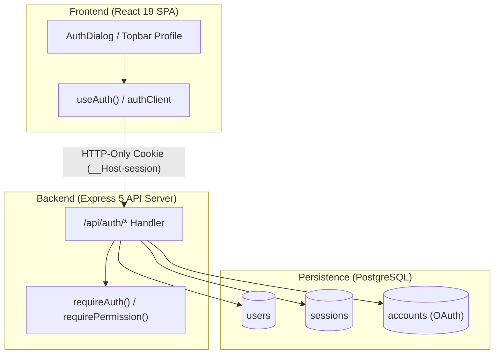
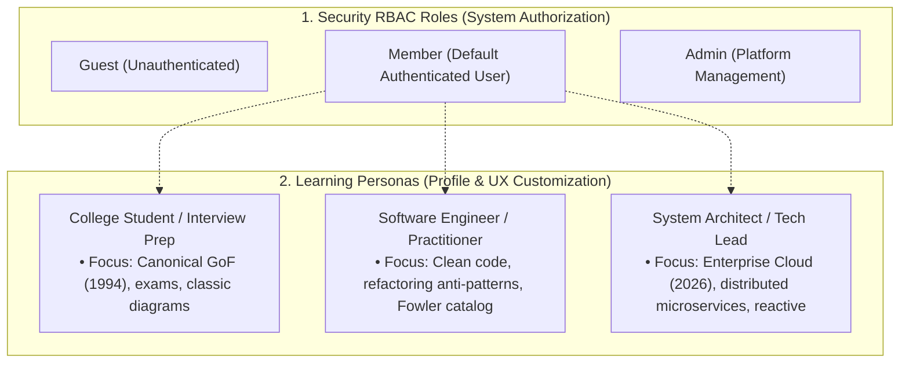
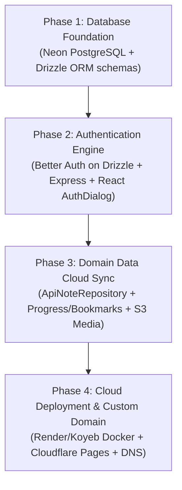

# Architectural Report: Authentication, Session Management, RBAC & Identity Architecture

**Document ID:** ARCH-2026-005  
**Status:** Proposed / Under Review  
**Date:** 2026-10-13  
**Domain:** Identity, Authentication & Authorization  
**Author:** Antigravity Engineering Agent  

---

## 1. Executive Summary & Core Requirements

This document establishes the architecture for secure user authentication (**AuthN**), authorization (**AuthZ**), session persistence, and Identity Provider (**IdP**) integrations for the **GoF Design Patterns Masterclass** platform.

### Requirements Addressed:
1. **Multi-Modal Authentication**: Support traditional email/password credentials with secure Argon2id/scrypt hashing alongside one-click **Google OAuth 2.0** and **GitHub OAuth 2.0** social sign-in.
2. **Robust Session Management**: Secure, tamper-proof session tracking using hardened HTTP-only cookies (`__Host-session`) resistant to XSS and CSRF attacks.
3. **Role-Based Access Control (RBAC)**: Hierarchical roles (`admin`, `instructor`, `student`, `guest`) paired with fine-grained action permissions.
4. **Zero-Trust Separation**: Strict isolation between user identity and AI Bring-Your-Own-Key (BYOK) credentials—API keys remain strictly ephemeral in React RAM and are **never stored in the database or session cookies**.
5. **UI Consistency**: Full alignment with the monorepo's Tailwind CSS v4 design system, Radix UI accessible primitives, and dark/light theme switching.

---

## 2. Authentication Strategy Evaluation

We evaluated three potential architectural approaches for this Node.js Express 5 + React 19 + PostgreSQL Drizzle stack:



### Architectural Comparison Matrix

| Criteria | Option A: Better Auth + Drizzle Adapter *(Recommended)* | Option B: Custom Session Store (Argon2 + Arctic + Express) | Option C: Managed Auth (Clerk / Supabase Auth) |
| :--- | :--- | :--- | :--- |
| **Monorepo / Drizzle Fit** | **Native**: First-class `@better-auth/drizzle-adapter` and PostgreSQL schema generation. | **High**: Complete manual control over Drizzle tables. | **Moderate**: External schemas, webhooks needed to mirror DB. |
| **Express 5 Support** | **Built-in**: Native `toNodeHandler(auth)` middleware. | **Native**: Standard Express middlewares. | **External**: JWT verification middleware. |
| **OAuth Providers** | **Out-of-the-box**: Google, GitHub with PKCE auto-configured. | **Manual**: Require wiring Arctic/Passport routes, state, and callbacks. | **Out-of-the-box**: Managed hosted UI or SDK. |
| **RBAC & Permissions** | **Built-in**: Official `admin` and `access` (RBAC) plugins. | **Manual**: Custom middleware and permission bitmasks/arrays. | **Tier-gated**: Often locked behind expensive enterprise tiers. |
| **React 19 Compatibility** | **Native**: Modern TypeScript client (`createAuthClient`). | **Manual**: Custom React Context and TanStack Query hooks. | **Native**: React component libraries. |
| **Self-Hosting / Cost** | **100% Free & Open Source**: Zero vendor lock-in. | **100% Free & Open Source**: Zero vendor lock-in. | **Paid / Freemium**: Free up to 10k MAU, steep pricing cliffs. |

### Decision: Option A (Better Auth with Drizzle Adapter)
Better Auth is purpose-built for TypeScript monorepos using Drizzle ORM and Express. It eliminates thousands of lines of boilerplate security code (CSRF token issuance, PKCE parameter validation, password hashing timing defense, rate-limiting) while providing zero vendor lock-in and running entirely within our existing PostgreSQL database.

---

## 3. Database Schema for Identity & Sessions (`lib/db`)

Better Auth with Drizzle ORM manages four core PostgreSQL tables in `lib/db/src/schema/auth.ts`:

```typescript
import { pgTable, text, timestamp, boolean, index } from "drizzle-orm/pg-core";

// 1. Core Users Table
export const usersTable = pgTable("users", {
  id: text("id").primaryKey(),
  name: text("name").notNull(),
  email: text("email").notNull().unique(),
  emailVerified: boolean("email_verified").notNull().default(false),
  image: text("image"),
  role: text("role").notNull().default("student"), // 'admin' | 'instructor' | 'student'
  banned: boolean("banned").default(false),
  banReason: text("ban_reason"),
  createdAt: timestamp("created_at", { withTimezone: true }).defaultNow().notNull(),
  updatedAt: timestamp("updated_at", { withTimezone: true }).defaultNow().notNull(),
});

// 2. Active Session Records
export const sessionsTable = pgTable("sessions", {
  id: text("id").primaryKey(),
  userId: text("user_id").notNull().references(() => usersTable.id, { onDelete: "cascade" }),
  token: text("token").notNull().unique(),
  expiresAt: timestamp("expires_at", { withTimezone: true }).notNull(),
  ipAddress: text("ip_address"),
  userAgent: text("user_agent"),
  createdAt: timestamp("created_at", { withTimezone: true }).defaultNow().notNull(),
  updatedAt: timestamp("updated_at", { withTimezone: true }).defaultNow().notNull(),
}, (table) => [
  index("session_user_idx").on(table.userId),
]);

// 3. OAuth Accounts & Linked Credentials
export const accountsTable = pgTable("accounts", {
  id: text("id").primaryKey(),
  userId: text("user_id").notNull().references(() => usersTable.id, { onDelete: "cascade" }),
  accountId: text("account_id").notNull(),
  providerId: text("provider_id").notNull(), // 'google' | 'github' | 'credential'
  accessToken: text("access_token"),
  refreshToken: text("refresh_token"),
  idToken: text("id_token"),
  password: text("password"), // Secure Argon2id hashed password
  expiresAt: timestamp("expires_at", { withTimezone: true }),
  createdAt: timestamp("created_at", { withTimezone: true }).defaultNow().notNull(),
  updatedAt: timestamp("updated_at", { withTimezone: true }).defaultNow().notNull(),
}, (table) => [
  index("account_user_idx").on(table.userId),
]);

// 4. Verification Tokens (Email Verification & Password Reset)
export const verificationsTable = pgTable("verifications", {
  id: text("id").primaryKey(),
  identifier: text("identifier").notNull(),
  value: text("value").notNull(),
  expiresAt: timestamp("expires_at", { withTimezone: true }).notNull(),
  createdAt: timestamp("created_at", { withTimezone: true }).defaultNow().notNull(),
  updatedAt: timestamp("updated_at", { withTimezone: true }).defaultNow().notNull(),
});
```

---

## 4. Role-Based Access Control (RBAC) vs. User Personas

### 4.1 Deconstructing "Student" vs "Instructor": Roles vs Personas
In earlier drafts, generic LMS terms (`student` vs `instructor`) were referenced. However, the **GoF Design Patterns Masterclass** serves a broad spectrum of engineers—from college undergraduates and interview candidates to senior developers, tech leads, and enterprise cloud architects.

Calling a 15-year veteran staff engineer a "student" is inaccurate and patronizing. Furthermore, unless the platform hosts formal teacher-led classrooms, an "instructor" security role introduces unnecessary complexity.

We therefore establish a clean separation between **Security RBAC Roles** and **User Personas**:



1. **Security RBAC Roles (System-Enforced Authorization)**:
   * **`guest`**: Unauthenticated visitor. Can read pattern catalog, execute client-side TypeScript in-browser via Web Worker, and run offline heuristic decision evaluations.
   * **`member`**: Standard authenticated user. Has persistent cloud sync for progress, bookmarks, personal BlockNote rich notes, Backblaze B2 / R2 diagram uploads, and Java JDK sandbox execution.
   * **`admin`**: System administrator. Has full access to user management, sandbox quota overrides, and execution queue metrics.

2. **Learning Personas (User Profile Track — Chosen by the Learner)**:
   * **`Student / Academics`**: Preparing for university exams or Big Tech coding interviews. Defaults to *Canonical GoF (1994)* view and academic literature citations.
   * **`Software Engineer`**: Practicing clean code and refactoring. Defaults to modern TypeScript/Java implementations with Fowler refactoring links.
   * **`System Architect`**: Designing high-load distributed systems. Defaults to *Enterprise Cloud (2026)* view (Serverless, Kubernetes, Outbox Pattern, Saga, Reactive).

---

### 4.2 Sign-Up Role Policy: Can Users Select Their Role During Registration?

> [!CAUTION]
> **Security Rule: Users must NEVER be allowed to select their security RBAC role during sign-up.**
> Allowing users to submit `role: "admin"` in a registration payload is an OWASP Top 10 vulnerability (**Privilege Escalation via Mass Assignment / CWE-269**).

* **Registration Security Rule**: Every user signing up is **strictly assigned `role: "member"` by backend logic**. Any `role` field passed from the frontend is discarded.
* **What Users CAN Select During Sign-Up**:
  * Users can select their **Learning Persona / Experience Track** (`Student`, `Software Engineer`, or `System Architect`) and **Primary Language** (`TypeScript` or `Java`).
  * This preference is stored in `users.persona` and customizes their default UI perspective and difficulty recommendations without granting privileged system access.
* **How `admin` is Assigned**:
  1. Configured via environment variable allowlist: `ADMIN_EMAILS="admin@yourdomain.com"`.
  2. Promoted via a secure internal CLI script: `pnpm --filter @workspace/api-server run promote-admin --email user@domain.com`.
  3. Promoted by an existing administrator through an authenticated admin panel.

---

### 4.3 Permissions Matrix

| Permission Key | Description | Guest | Member (All Personas) | Admin |
| :--- | :--- | :---: | :---: | :---: |
| `patterns:read` | Browse 23 GoF pattern catalog & principles | ✅ | ✅ | ✅ |
| `code:execute_local` | Run TypeScript code via in-browser Web Worker | ✅ | ✅ | ✅ |
| `code:execute_sandbox` | Run Java code via backend JDK 25 container | ❌ *(5/day)* | ✅ *(150/day)* | ✅ *(Unlimited)* |
| `copilot:byok` | Use AI Architect Copilot with client RAM keys | ✅ | ✅ | ✅ |
| `notes:read` | View personal rich notes | Local only | ✅ (Cloud sync) | ✅ (Cloud sync) |
| `notes:write` | Create / update rich notes | Local only | ✅ | ✅ |
| `notes:delete` | Delete personal notes | Local only | ✅ | ✅ |
| `media:upload` | Upload images to Backblaze B2 / R2 | ❌ | ✅ (Max 10MB) | ✅ (Max 50MB) |
| `admin:users_manage` | Ban, inspect, or manage user roles | ❌ | ❌ | ✅ |
| `admin:system_metrics` | View system health & execution queue metrics | ❌ | ❌ | ✅ |

---

### 4.4 Declarative Access Control (`artifacts/api-server/src/lib/permissions.ts`)

```typescript
import { createAccessControl } from "better-auth/plugins/access";

export const statement = {
  pattern: ["read"],
  notes: ["create", "read", "update", "delete"],
  code: ["execute_local", "execute_sandbox"],
  media: ["upload", "delete"],
  admin: ["manage_users", "view_metrics"],
} as const;

export const ac = createAccessControl(statement);

export const roles = {
  guest: ac.newRole({
    pattern: ["read"],
    code: ["execute_local"],
  }),
  member: ac.newRole({
    pattern: ["read"],
    code: ["execute_local", "execute_sandbox"],
    notes: ["create", "read", "update", "delete"],
    media: ["upload", "delete"],
  }),
  admin: ac.newRole({
    pattern: ["read"],
    code: ["execute_local", "execute_sandbox"],
    notes: ["create", "read", "update", "delete"],
    media: ["upload", "delete"],
    admin: ["manage_users", "view_metrics"],
  }),
};
```


---

## 5. Backend Server Implementation (`artifacts/api-server`)

### 5.1 Auth Instance Configuration (`src/lib/auth.ts`)
```typescript
import { betterAuth } from "better-auth";
import { drizzleAdapter } from "@better-auth/drizzle-adapter";
import { admin } from "better-auth/plugins";
import { db } from "@workspace/db";
import * as schema from "@workspace/db/schema";
import { ac, roles } from "./permissions";

export const auth = betterAuth({
  database: drizzleAdapter(db, {
    provider: "pg",
    schema,
  }),
  emailAndPassword: {
    enabled: true,
    requireEmailVerification: false, // Set true in production with SMTP
  },
  socialProviders: {
    google: {
      clientId: process.env.GOOGLE_CLIENT_ID || "",
      clientSecret: process.env.GOOGLE_CLIENT_SECRET || "",
      enabled: Boolean(process.env.GOOGLE_CLIENT_ID),
    },
    github: {
      clientId: process.env.GITHUB_CLIENT_ID || "",
      clientSecret: process.env.GITHUB_CLIENT_SECRET || "",
      enabled: Boolean(process.env.GITHUB_CLIENT_ID),
    },
  },
  plugins: [
    admin({
      defaultRole: "student",
      adminUserIds: (process.env.INITIAL_ADMIN_IDS || "").split(",").filter(Boolean),
    }),
  ],
  session: {
    cookieCache: { enabled: true, maxAge: 5 * 60 }, // 5-minute memory cache
    expiresIn: 60 * 60 * 24 * 14, // 14-day rolling session
  },
});
```

### 5.2 Express Middleware Mounting (`src/app.ts`)
```typescript
import express from "express";
import { toNodeHandler } from "better-auth/node";
import { auth } from "./lib/auth";

const app = express();

// Mount all /api/auth/* endpoints (sign-in, sign-up, sign-out, session, oauth callbacks)
app.all("/api/auth/*", toNodeHandler(auth));

app.use(express.json());
```

### 5.3 Typed Session & Role Guard Middlewares (`src/middlewares/auth.ts`)
```typescript
import type { Request, Response, NextFunction } from "express";
import { auth } from "../lib/auth";

export interface AuthenticatedRequest extends Request {
  user: typeof auth.$Infer.Session.user;
  session: typeof auth.$Infer.Session.session;
}

export async function requireAuth(req: Request, res: Response, next: NextFunction) {
  const session = await auth.api.getSession({ headers: req.headers });
  if (!session) {
    return res.status(401).json({
      error: { code: "UNAUTHORIZED", message: "Authentication required" },
    });
  }
  (req as AuthenticatedRequest).user = session.user;
  (req as AuthenticatedRequest).session = session.session;
  return next();
}

export function requireRole(allowedRoles: string[]) {
  return (req: Request, res: Response, next: NextFunction) => {
    const user = (req as AuthenticatedRequest).user;
    if (!user || !allowedRoles.includes(user.role)) {
      return res.status(403).json({
        error: { code: "FORBIDDEN", message: "Insufficient privileges" },
      });
    }
    return next();
  };
}
```

---

## 6. Frontend Client Integration (`artifacts/pattern-masterclass`)

### 6.1 Better Auth React Client (`src/lib/auth-client.ts`)
```typescript
import { createAuthClient } from "better-auth/client";
import { adminClient } from "better-auth/client/plugins";

export const authClient = createAuthClient({
  baseURL: import.meta.env.VITE_API_BASE_URL || "", // Empty string routes via reverse proxy / Vite proxy
  plugins: [adminClient()],
});

export const { useSession, signIn, signUp, signOut } = authClient;
```

### 6.2 Top Header UI Architecture (Common Across All Pages)

The top navigation header in `artifacts/pattern-masterclass/src/App.tsx` is standardized across all screens (Pattern Catalog, Code Playground, Decision Engine, Notes Workspace, Scenario Lab).

#### A. Unauthenticated State (Visitor / Guest):
```text
┌────────────────────────────────────────────────────────────────────────────────────────────────────────────────────────┐
│ [≡]  GOF DESIGN PATTERNS  >  CATALOG              [Ctrl+K Search...]     [🎓|🏢]  [⛶ Focus]  [☼ Light]  ┌─────────────┐│
│                                                                                                         │  [Sign In]  ││
│                                                                                                         └─────────────┘│
└────────────────────────────────────────────────────────────────────────────────────────────────────────────────────────┘
```
* **Trigger**: Clicking `[Sign In]` opens the `<AuthDialog />` modal.

#### B. Authenticated State (Logged In Learner):
```text
┌────────────────────────────────────────────────────────────────────────────────────────────────────────────────────────┐
│ [≡]  GOF DESIGN PATTERNS  >  CATALOG              [Ctrl+K Search...]     [🎓|🏢]  [⛶ Focus]  [☼ Light]  ┌─ [☁ Synced] ┐│
│                                                                                                         │ (JD) John ▼ ││
│                                                                                                         └─────────────┘│
└────────────────────────────────────────────────────────────────────────────────────────────────────────────────────────┘
```
* **Avatar & Indicator**: Displays user initials (`JD`) or avatar image, display name, and a green `[☁ Synced]` indicator confirming cloud connection.
* **Dropdown Trigger**: Clicking the avatar opens the **User Profile Dropdown**.

---

### 6.3 User Profile Dropdown Menu ASCII Design

```text
                                                                                        ┌──────────────────────────────────────┐
                                                                                        │ John Doe                             │
                                                                                        │ john.doe@example.com                 │
                                                                                        │ [Badge: Software Engineer] [Member]  │
                                                                                        ├──────────────────────────────────────┤
                                                                                        │ ☁ Cloud Storage: Connected (Neon PG) │
                                                                                        │ 📦 14 Bookmarks  ·  8 Pattern Notes  │
                                                                                        │ 🎯 Leitner Spaced Mastery: Box 3/5   │
                                                                                        ├──────────────────────────────────────┤
                                                                                        │ ⚙ Account Settings                   │
                                                                                        │ 🎓 Switch Persona Track...           │
                                                                                        │ 📥 Export Offline JSON Backup        │
                                                                                        ├──────────────────────────────────────┤
                                                                                        │ 🚪 Sign Out                          │
                                                                                        └──────────────────────────────────────┘
```

---

### 6.4 Unified Authentication Modal (`<AuthDialog />`) ASCII Wireframe

```text
┌────────────────────────────────────────────────────────────────────────┐
│  Sign in to GoF Masterclass                                       [✕]  │
│  Sync your pattern notes, bookmarks, and Leitner progress everywhere   │
│                                                                        │
│   ┌──────────────────────────────┬──────────────────────────────┐      │
│   │     [ Sign In (Active) ]     │      Create Account          │      │
│   └──────────────────────────────┴──────────────────────────────┘      │
│                                                                        │
│   ┌────────────────────────────────────────────────────────────────┐   │
│   │  [G]  Continue with Google                                     │   │
│   └────────────────────────────────────────────────────────────────┘   │
│   ┌────────────────────────────────────────────────────────────────┐   │
│   │  [🐙] Continue with GitHub                                     │   │
│   └────────────────────────────────────────────────────────────────┘   │
│                                                                        │
│   ─────────────── or continue with email and password ───────────────   │
│                                                                        │
│   Email address                                                        │
│   ┌────────────────────────────────────────────────────────────────┐   │
│   │ alex.developer@example.com                                     │   │
│   └────────────────────────────────────────────────────────────────┘   │
│                                                                        │
│   Password                                             [Forgot?]       │
│   ┌───────────────────────────────────────────────────────┬────────┐   │
│   │ ••••••••••••••••••••••••••••••••••••••••••••••••••••• │ [👁 Show]│   │
│   └───────────────────────────────────────────────────────┴────────┘   │
│                                                                        │
│   ┌────────────────────────────────────────────────────────────────┐   │
│   │                     Sign In to Account                         │   │
│   └────────────────────────────────────────────────────────────────┘   │
│                                                                        │
│   Don't have an account yet? Create one now                            │
└────────────────────────────────────────────────────────────────────────┘
```

#### Registration Tab with Persona Selector:
When switching to the **`Create Account`** tab:
```text
│   Choose your Experience Track (Tailors your default view):            │
│   ┌───────────────────┐ ┌───────────────────────┐ ┌──────────────────┐ │
│   │ [🎓 Student]      │ │ [💻 Software Eng (✓)] │ │ [🏛 System Arch] │ │
│   │ Canonical GoF     │ │ Clean Code & Refactor │ │ Cloud Enterprise │ │
│   └───────────────────┘ └───────────────────────┘ └──────────────────┘ │
```

---

## 7. Security Hardening & Zero-Trust Guarantees

1. **Cookie Configuration**:
   - `HttpOnly`: Yes (JavaScript cannot read the session cookie; protects against XSS token extraction).
   - `Secure`: Yes in production (Transmitted strictly over HTTPS).
   - `SameSite=Lax`: Defends against Cross-Site Request Forgery (CSRF).
   - Cookie name: Prefix with `__Host-` in production to enforce domain matching and SSL.
2. **Rate Limiting**:
   - Limit `/api/auth/sign-in` to 5 failed attempts per IP per 15 minutes using an in-memory token bucket or Redis.
3. **Zero-Trust BYOK Guarantee Preserved**:
   - The user's Google Gemini, OpenAI, or Groq API keys remain strictly stored in `React RAM` inside `BYOKModal.tsx`.
   - Logging in or signing out **never transmits** or persists LLM keys to the database.

---

## 8. Strategic Execution Sequence: What to Build First?

When architecting this transition, developers often ask: *"Should we build Login first, Database first, or Deployment first?"*

### Dependency DAG Analysis:



### Why this sequence is mathematically optimal:
1. **Database MUST be first**: Better Auth requires active database tables (`users`, `sessions`, `accounts`, `verifications`) to operate. You cannot test or build authentication without a database.
2. **Authentication MUST precede Cloud Sync**: Progress, bookmarks, and rich notes are multi-tenant and belong to specific `userId`s. You cannot save a note to a database user row before you have authenticated user sessions.
3. **Domain Sync MUST precede Production Deployment**: Deploying an app to a live custom domain before DB and Auth work means pushing non-functional or mock code to your public users.

### Step-by-Step Delivery Milestones:
* **Milestone 1 (Database)**: Provision Neon Postgres -> write Drizzle schemas in `lib/db/src/schema/` -> `drizzle-kit push`.
* **Milestone 2 (Auth)**: Mount Better Auth in Express -> write `<AuthDialog />` and Header profile dropdown in Vite -> verify session cookies.
* **Milestone 3 (Sync & S3)**: Implement `ApiNoteRepository` -> wire presigned S3 uploads for Backblaze B2 / R2 -> build local-to-cloud migration prompt.
* **Milestone 4 (Deploy)**: Build multi-stage Docker container -> deploy to Render/Koyeb -> deploy frontend to Cloudflare Pages -> configure custom domain routing (`/api/*`).

