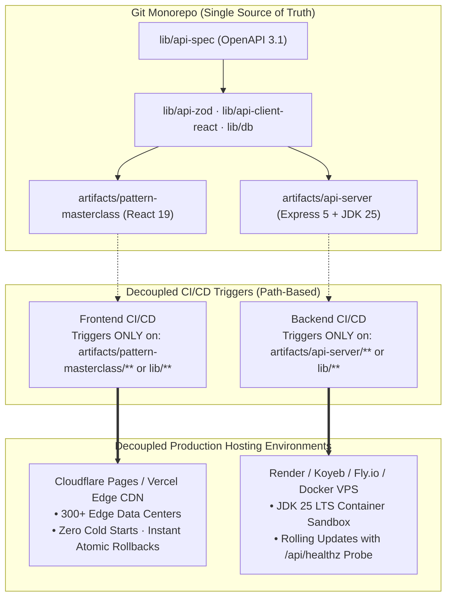
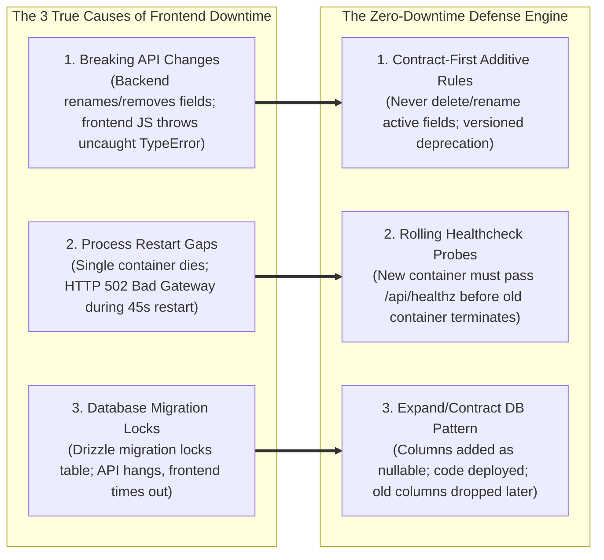
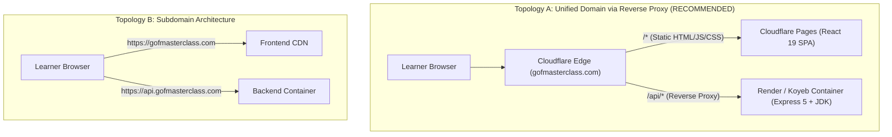

# Architectural Report: Monorepo Deployment, Decoupled CI/CD & Custom Domain Strategy

**Document ID:** ARCH-2026-006  
**Status:** Proposed / Under Review  
**Date:** 2026-10-13  
**Domain:** DevOps, Deployment Architecture & Monorepo Topology  
**Author:** Antigravity Engineering Agent  

---

## 1. Executive Summary & Core Inquiries

This document addresses the user's specific operational, architectural, and deployment questions:

1. **Monorepo Deployment Challenges**: How does deploying a monorepo work in production, and what are the specific friction points?
2. **Backend Upgrade vs. Frontend Downtime**: Does upgrading a single backend service in a monorepo cause frontend downtime, why does this happen, and how do we achieve **100% zero downtime**?
3. **Decoupling & Sub-Repo Modularization**: How can we modularize the codebase, should we split into independent sub-repos (polyrepo), and what are the trade-offs?
4. **Custom Domain & Public Availability**: How do we route a custom domain (e.g., `gofmasterclass.com`) across static edge frontend and containerized backend services securely and cheaply?

---

## 2. Monorepo vs. Polyrepo Analysis & Decoupling Blueprint

A common architectural misconception is that **"code that lives in the same Git repository must be deployed together."** This is false. A monorepo organizes *source code and developer contracts*; deployment pipelines organize *runtime binaries*.



### 2.1 The Two Decoupling Strategies Compared

#### Strategy A: Decoupled Independent CI/CD within Monorepo *(Strongly Recommended)*
* **How it works**: The repository remains a single Git repository. CI/CD pipelines use **path-based change detection** (e.g., GitHub Actions `paths: ['artifacts/api-server/**', 'lib/**']`).
* **Upgrading Backend**: Pushing a commit that touches only backend files triggers **only the backend container rebuild**. The frontend is completely untouched and experiences **zero build activity and zero downtime**.
* **Contract Protection**: If a backend engineer makes a breaking API schema change, `pnpm run typecheck` fails **immediately at commit time**, preventing broken code from ever reaching production.

#### Strategy B: Multi-Repo (Polyrepo / Sub-Repos)
* **How it works**: Split into `gof-frontend` and `gof-backend` repositories, with `gof-contracts` published as an npm package.
* **The Reality of Polyrepos**:
  1. **Contract Drift**: To update an API endpoint, you must:
     - Push to `gof-contracts` repo.
     - Wait for npm package publish (`@gof/api-client@1.2.0`).
     - Open PR in `gof-backend` repo and update dependency.
     - Open PR in `gof-frontend` repo and update dependency.
  2. **Invisible Breakages**: Neither repository's CI can test whether the other repository is broken until runtime.
  3. **Multiplied Maintenance**: Duplicate configuration across ESLint, Prettier, TypeScript, Dockerfiles, and CI secrets.

### Architectural Verdict:
**Retain the Git Monorepo for shared compile-time contracts, but completely decouple CI/CD and deployment runtimes.** You get all the benefits of independent micro-deployments with none of the dependency hell of polyrepos.

---

## 3. The Truth About Backend Upgrades & Frontend Downtime

### 3.1 Why Does Backend Upgrading Sometimes Cause Frontend Downtime?
In flawed architectures, backend updates cause frontend issues due to **three specific root causes**:



### 3.2 The Zero-Downtime Defense Strategy

#### Defense 1: Contract-First Additive API Evolution
* **Golden Rule**: **All API changes must be purely additive.**
* When evolving an endpoint:
  1. Never delete or rename existing response properties.
  2. Add new fields with default or optional values.
  3. If a breaking structural redesign is required, introduce a new path (`/api/v2/notes`) while keeping `/api/v1/notes` active until the frontend has migrated.

#### Defense 2: Rolling Healthchecked Deployments (Blue/Green)
* Never kill an active backend process before the new version is verified ready.
* In your container orchestrator (Render, Koyeb, Docker Swarm, Kubernetes):
  1. The orchestrator boots `Container v2`.
  2. The orchestrator repeatedly probes `GET http://localhost:3000/api/healthz`.
  3. **Only when `/api/healthz` returns `HTTP 200 OK`** does the load balancer direct incoming user traffic to `Container v2`.
  4. The load balancer drains active connections from `Container v1` over a 30-second window, then cleanly terminates `Container v1`.
* **Result**: The frontend never sees a dropped packet or a 502 gateway error.

#### Defense 3: Expand-Contract Database Migrations
When changing database schemas:
* **Step 1 (Expand)**: Add the new column as `NULLABLE` in Drizzle ORM (`drizzle-kit push`).
* **Step 2 (Deploy Backend)**: Deploy the updated backend code that writes to both old and new columns.
* **Step 3 (Backfill)**: Run a script to copy historical data from old to new.
* **Step 4 (Contract)**: Once confirmed, deploy backend reading exclusively from the new column, and drop the old column.

#### Defense 4: Frontend Network Resilience (TanStack Query)
Even if the backend experiences an ephemeral network blip, the frontend will not crash:
1. **Stale-While-Revalidate**: TanStack Query instantly displays the cached version of notes or progress from memory/storage.
2. **Exponential Backoff**: Failed network requests automatically retry at 1s, 2s, and 4s intervals.
3. **Optimistic Updates**: When the user bookmarks a pattern or updates notes, UI updates instantly without waiting for the server response.

---

## 4. Custom Domain & Public Availability Topology

When deploying to a custom domain (e.g., `gofmasterclass.com`), you have two distinct routing architectures:



### 4.1 Topology Comparison

| Factor | Topology A: Unified Domain (`/` + `/api/*`) *(Recommended)* | Topology B: Subdomain (`gofmasterclass.com` + `api.gofmasterclass.com`) |
| :--- | :--- | :--- |
| **CORS Complexities** | **Zero CORS issues**. All requests are same-origin (`/api/*`). | Requires complex CORS headers, origins allowlists, and preflight `OPTIONS` requests. |
| **Network Latency** | **Fastest**: Zero preflight OPTIONS roundtrips (saves 50–150ms per call). | Slower: Every mutation requires an `OPTIONS` flight before the actual `POST`/`PUT`. |
| **Cookie & Session Security** | **Maximum Security**: `SameSite=Lax` cookies work automatically without third-party cookie blocking. | Requires explicit `Domain=.gofmasterclass.com` cookie configuration. |
| **Custom Domain SSL** | **Single Certificate**: One SSL cert on `gofmasterclass.com`. | Two SSL certificates needed. |

### 4.2 Implementing Topology A with Cloudflare (Free & Production-Ready)

Cloudflare provides free edge routing via **Cloudflare Pages** and a simple edge function or origin rule:

#### 1. Frontend Build Settings (Cloudflare Pages):
* **Project Name**: `gof-masterclass`
* **Root Directory**: `artifacts/pattern-masterclass`
* **Build Command**: `pnpm run build`
* **Build Output Directory**: `dist/public`

#### 2. SPA Route Fallback (`artifacts/pattern-masterclass/public/_redirects`):
```text
# Route API calls directly to Render backend container
/api/*  https://gof-masterclass-api.onrender.com/api/:splat  200

# Route all SPA client paths to index.html
/*      /index.html                                          200
```

By adding this 2-line file, Cloudflare Edge automatically proxies `/api/*` requests directly to your backend container while keeping the client URL completely transparent (`https://gofmasterclass.com/api/code/run`).

---

## 5. Independent CI/CD Pipeline Definitions

Here is the decoupled GitHub Actions pipeline demonstrating zero coupling between frontend and backend deployments:

### 5.1 Backend Deployment Pipeline (`.github/workflows/deploy-backend.yml`)
```yaml
name: Deploy Backend Service

on:
  push:
    branches: [main]
    paths:
      - 'artifacts/api-server/**'
      - 'lib/api-spec/**'
      - 'lib/api-zod/**'
      - 'lib/db/**'
      - 'Dockerfile.backend'
      - 'package.json'
      - 'pnpm-workspace.yaml'

jobs:
  build-and-deploy:
    runs-on: ubuntu-latest
    steps:
      - uses: actions/checkout@v4
      
      - name: Setup Node & pnpm
        uses: pnpm/action-setup@v3
        with:
          version: 10
      
      - name: Run Typecheck
        run: pnpm --filter @workspace/api-server run typecheck

      - name: Trigger Webhook / Build Docker Container
        run: |
          curl -X POST "${{ secrets.RENDER_DEPLOY_HOOK_URL }}"
```

### 5.2 Frontend Deployment Pipeline (`.github/workflows/deploy-frontend.yml`)
```yaml
name: Deploy Frontend SPA

on:
  push:
    branches: [main]
    paths:
      - 'artifacts/pattern-masterclass/**'
      - 'lib/api-client-react/**'
      - 'lib/api-spec/**'
      - 'package.json'
      - 'pnpm-workspace.yaml'

jobs:
  build-and-deploy:
    runs-on: ubuntu-latest
    steps:
      - uses: actions/checkout@v4
      
      - name: Setup Node & pnpm
        uses: pnpm/action-setup@v3
        with:
          version: 10

      - name: Run Frontend Typecheck
        run: pnpm --filter @workspace/pattern-masterclass run typecheck

      - name: Deploy to Cloudflare Pages
        uses: cloudflare/pages-action@v1
        with:
          apiToken: ${{ secrets.CLOUDFLARE_API_TOKEN }}
          accountId: ${{ secrets.CLOUDFLARE_ACCOUNT_ID }}
          projectName: gof-masterclass
          directory: artifacts/pattern-masterclass/dist/public
```

---

## 6. Production Custom Domain Setup Runbook

Follow these steps to connect your custom domain to production:

### Step 1: DNS Configuration (Cloudflare / Namecheap / GoDaddy)
Configure your domain DNS zone as follows:

| Type | Name | Content / Target | Proxy Status | Purpose |
| :--- | :--- | :--- | :---: | :--- |
| **CNAME** | `@` (or `gofmasterclass.com`) | `gof-masterclass.pages.dev` | **Proxied (Orange Cloud)** | Edge CDN for Frontend & Routing |
| **CNAME** | `www` | `gofmasterclass.com` | **Proxied (Orange Cloud)** | Canonical Redirect |
| **CNAME** | `api-origin` | `gof-masterclass-api.onrender.com` | **DNS Only (Grey Cloud)** | Direct Container Backend Origin |

### Step 2: SSL/TLS Encryption
* Inside Cloudflare Dashboard:
  - Go to **SSL/TLS** -> Select **Full (Strict)**.
  - Enable **Always Use HTTPS**.
  - Enable **HTTP/3 (with QUIC)** and **0-RTT Connection Resumption**.

### Step 3: Health Probe Monitoring
Set up a free uptime monitor (e.g., Better Uptime or UptimeRobot) pinging:
* `https://gofmasterclass.com/api/healthz` every 60 seconds.
* This ensures you are alerted immediately if database connectivity or the Java container fails, completely independent of frontend status.

---

## 7. Summary & Recommendations Checklist

| Question | Recommended Architecture | Reason |
| :--- | :--- | :--- |
| **Monorepo vs Polyrepo?** | **Retain Monorepo in Git** | Guarantees zero contract drift across OpenAPI, Zod, and React Query with shared compile-time type safety. |
| **CI/CD Coupling?** | **Decouple via Path Filters** | Backend deploys only when backend code changes. Frontend deploys only when frontend code changes. |
| **Avoid Frontend Downtime?** | **Rolling Deploys + Health Probes** | Backend containers roll with `/api/healthz` verification. APIs remain strictly additive. |
| **Custom Domain Topology?** | **Unified Domain (`gofmasterclass.com`)** | Proxies `/api/*` to backend. Eliminates CORS, removes preflight latency, guarantees secure cookies. |
