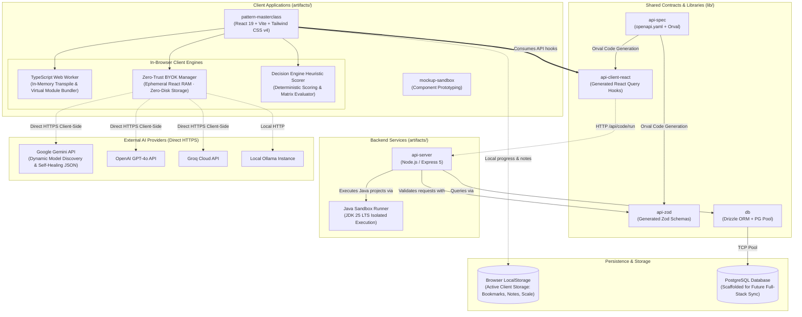
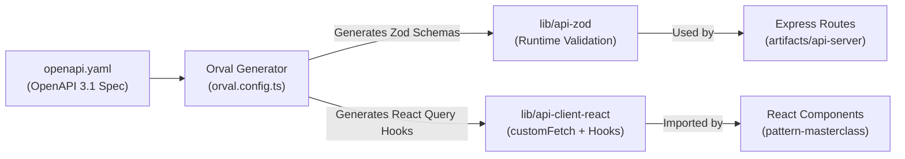
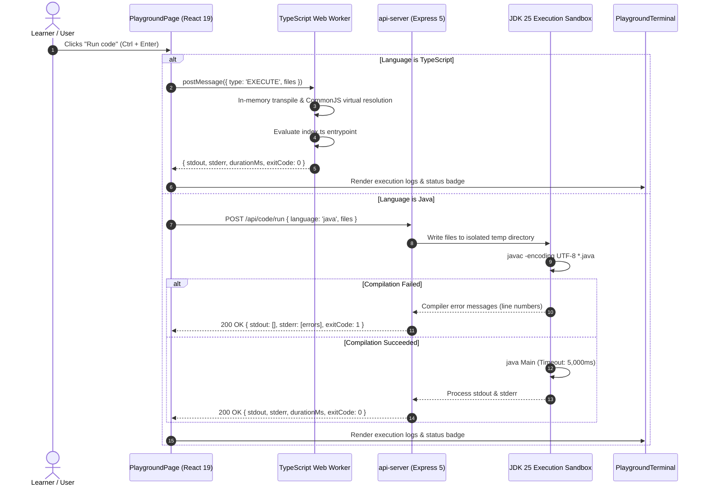
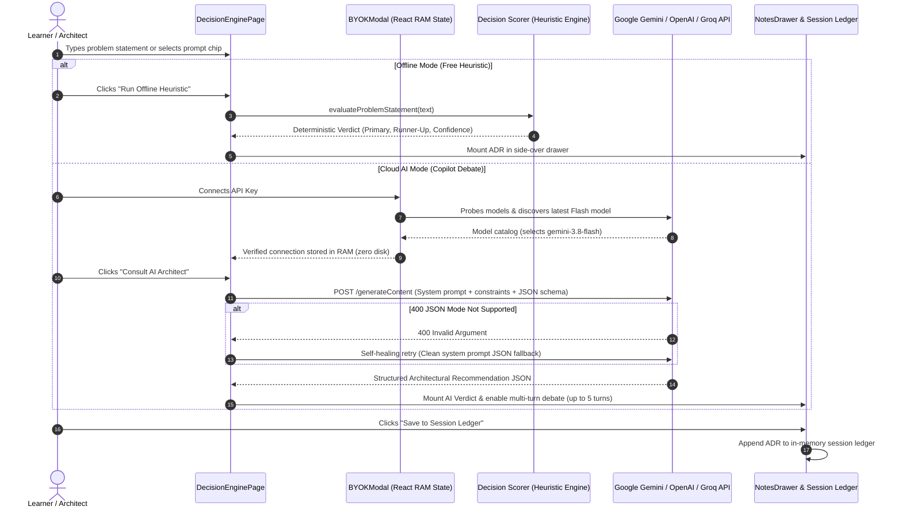

# System Architecture & Design Specification

This document details the architectural structure of the **GoF Design Patterns Masterclass** monorepo, including system topology, module responsibilities, code execution sandboxing, zero-trust security boundaries, API generation pipelines, and sequence diagrams illustrating runtime behavior.

---

## 1. High-Level System Architecture

The project is structured as a **pnpm monorepo** with strict modular separation between client applications (`artifacts/`), shared protocol packages (`lib/`), and backend services.

---

## 2. What We Achieved (Current Application Status)

### 2.1 Core Architectural Milestones
1. **Interactive Multi-File Code Playground**:
   - **Dual Execution Engines**: Client-side TypeScript compilation via Web Worker (zero UI freezes) and server-side Java compilation/execution via JDK 25 LTS sandbox.
   - **Multi-File Tabbed Workspace**: Create, rename, delete files with protected entry point contracts (`index.ts` / `Main.java`).
   - **Hybrid Resizable Viewport**: Stacked editorial flow vs. side-by-side resizable split view powered by `react-resizable-panels`.
   - **Strict Single-Scroll UX**: Zero double-scrollbar traps; code editor line numbers synchronize with textarea scroll.
2. **GoF Decision Engine (3 Core Pillars + AI Copilot)**:
   - **Pillar 1: Diagnostic Wizard**: 3-step decision flow mapped to the original GoF "Causes of Redesign", producing deterministic fit scores across all 23 patterns.
   - **Pillar 2: Real-World Scenario Matcher**: 16+ production enterprise architectural cases (Cloud, Fintech, Microservices, Canvas UI) with domain filtering.
   - **Pillar 3: Sibling Disambiguation (Versus Matrix)**: Side-by-side comparator resolving the 7 classic GoF dilemma pairs with decisive pivot rules and Fowler refactoring links.
   - **AI Architect Copilot with Zero-Trust BYOK**: Multi-turn architectural debate copilot supporting Google Gemini, OpenAI, Groq, and Ollama. Keys live **strictly in browser RAM** (zero disk storage). Includes future-proof dynamic Gemini model discovery filtering specialized audio/TTS models, with self-healing JSON mode fallback.
   - **Side-Over Notes Drawer & Session Decision Ledger**: Non-intrusive drawer housing the active Architectural Decision Record (ADR), session decision history, and field guide heuristics.
   - **Mobile-First Responsive Architecture**: Touch-optimized bottom sheet with grab handle and sticky docked verdict bar on viewports $< 768px$.
3. **Dual Perspective Catalog (All 23 Patterns)**:
   - **Canonical GoF (1994)** vs. **Enterprise Cloud (2026)**: Dual-perspective toggle across all 23 patterns detailing modern serverless, Kubernetes, and reactive event-driven adaptations.
   - **Normalized SOLID Principles Matrix**: Guaranteed deterministic impact-first ordering and literature citations for every pattern.
4. **Design System & Accessible Global Tooltips**:
   - Consistent Radix UI `<AppTooltip>` primitives across all candidate actions, topbar pills, drawer controls, playground tools, and theme toggles.
   - 100% solid, opaque popup cards (`#ffffff` / `#121620`) with dark scrim backdrops (`rgba(0, 0, 0, 0.88)`), eliminating text bleed-through.

---

## 3. How It Is (Technical Subsystems & Data Flow)

### 3.1 Contract-First API & Code Generation Pipeline
All backend endpoints are contractually governed by [lib/api-spec/openapi.yaml](file:///h:/System%20design/design-pattern/replet/design-patterns/lib/api-spec/openapi.yaml):

| Package | Role | Key File |
| :--- | :--- | :--- |
| **`lib/api-spec`** | Single Source of Truth for all API endpoints and schemas. | [openapi.yaml](file:///h:/System%20design/design-pattern/replet/design-patterns/lib/api-spec/openapi.yaml) |
| **`lib/api-zod`** | Compiles schemas into runtime validators for input/output boundaries. | [src/index.ts](file:///h:/System%20design/design-pattern/replet/design-patterns/lib/api-zod/src/index.ts) |
| **`lib/api-client-react`** | Auto-generates React Query hooks with automatic caching and retry logic. | [src/custom-fetch.ts](file:///h:/System%20design/design-pattern/replet/design-patterns/lib/api-client-react/src/custom-fetch.ts) |
| **`artifacts/api-server`** | Implements route handlers, middlewares (CORS, Pino logging), and Java execution sandbox. | [src/app.ts](file:///h:/System%20design/design-pattern/replet/design-patterns/artifacts/api-server/src/app.ts) |

---

### 3.2 Sequence Diagram: Interactive Code Playground Execution Flow

---

### 3.3 Sequence Diagram: Decision Engine & Zero-Trust Copilot Flow

---

## 4. Future Enhancements & Roadmap

1. **Full-Stack PostgreSQL State Sync**:
   - Transition bookmarks, quiz progress, and session decision ledgers from browser `localStorage` / memory into PostgreSQL via Drizzle ORM and auto-generated Orval hooks.
2. **Multi-Language Playground Extensions**:
   - Python sandbox using client-side Pyodide WASM Worker.
   - Go sandbox executing `go run .` within an ephemeral server container.
   - Rust and C# .NET sandbox runners.
3. **Pattern Studio & Scenario Lab Implementation**:
   - Interactive visual simulators (Strategy algorithm swap, Observer event mesh, Decorator stream wrapping) replacing the temporary WIP placeholders.
   - Leitner 5-box spaced repetition algorithm with adaptive review scheduling.
4. **Architectural Decision Ledger Export**:
   - Export full session ledger as industry-standard Markdown ADRs or JSON architecture specifications for CI/CD repository commits.

---

## 5. Architectural Quality Attributes

* **Zero-Trust Security**: API keys are held strictly in React RAM. Zero `localStorage` / zero `sessionStorage`. Keys are purged instantly on tab close.
* **Resilient Graceful Degradation**: If cloud AI APIs encounter rate limits, outages, or invalid keys, the application seamlessly falls back to deterministic offline heuristic evaluation.
* **Thread Isolation**: Code execution runs off the main thread (Web Worker or containerized backend), guaranteeing the UI remains responsive at 60 FPS even during infinite loops.
* **Strict Type Safety**: Monorepo enforced with zero `any` types. Schema changes in `openapi.yaml` propagate downstream through compile-time type verification.
