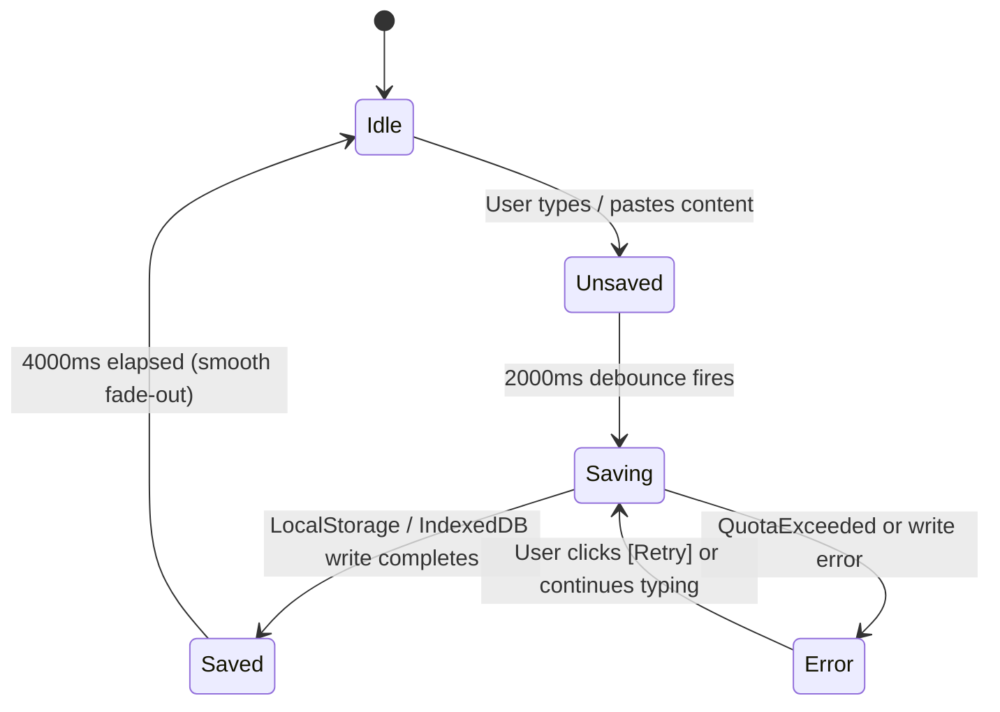
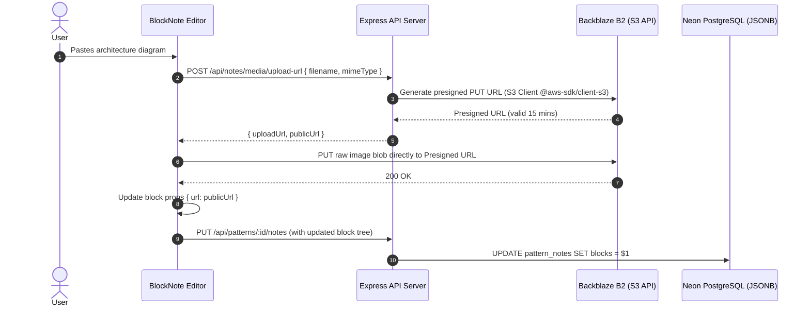

# Frontend & UX Specification: Per-Pattern Rich Notes

**Document ID:** SPEC-UI-2026-003  
**Status:** Ready for Review (Gate 2)  
**Date:** 2026-10-12  
**Context Reference:** [PRD-2026-003-v2](../prds/prd-per-pattern-notes.md) | [ADR-2026-003](../adr/2026-10-12-per-pattern-notes-architecture.md)  
**Author:** Antigravity Engineering Agent  

---

## 1. Design Philosophy & Aesthetic System

The Per-Pattern Rich Notes system is crafted as an unobtrusive, high-density study companion within the **GoF Design Patterns Masterclass**. It integrates seamlessly with the dark-mode aesthetic of the application, utilizing deep obsidian surfaces, refined borders, and the signature amber accent (`hsl(38 92% 50%)`).

### 1.1 Core Principles
1. **Zero Reading Occlusion**: Notes never appear as modal dialogs or obscure reference diagrams with backdrops.
2. **Zero 3rd-Nested-Scroll**: Hard mathematical limit of 2 scroll levels (frame + sibling panels).
3. **Tactile Geometry**: Fluid layout toggling between horizontal side-by-side and vertical stacked split panels with persistent position memory.
4. **Immediate Feedback**: Real-time save status indicator with debounced state transitions.

---

## 2. Design Tokens & Color Palette

All styling conforms to Tailwind CSS v4 variables defined in `@workspace/pattern-masterclass`:

| Token | CSS Variable / Value | Dark Mode (Default) | Light Mode | Application |
| :--- | :--- | :--- | :--- | :--- |
| **Surface Base** | `--background` | `hsl(224, 71%, 4%)` | `hsl(0, 0%, 100%)` | Viewport backdrop |
| **Notes Pane Bg** | `--card` | `hsl(224, 40%, 6%)` | `hsl(0, 0%, 97%)` | Notes editor container |
| **Editor Canvas** | `--card-foreground` | `hsl(210, 20%, 98%)` | `hsl(224, 71%, 4%)` | Text body foreground |
| **Panel Border** | `--border` | `hsl(216, 34%, 17%)` | `hsl(220, 13%, 91%)` | Separator dividers |
| **Accent Primary**| `--primary` / Amber | `hsl(38, 92%, 50%)` (`#f59e0b`) | `hsl(38, 92%, 50%)` | Unsaved dot, resize focus, active tabs |
| **Accent Glow** | Amber translucent | `hsla(38, 92%, 50%, 0.15)` | `hsla(38, 92%, 50%, 0.10)` | Active drag handle halo, drop zone |
| **Save Success** | Emerald green | `hsl(142, 70%, 45%)` (`#22c55e`) | `hsl(142, 76%, 36%)` | "Saved ✓" text and checkmark |
| **Save Error** | Coral red | `hsl(0, 84%, 60%)` (`#ef4444`) | `hsl(0, 72%, 51%)` | Save failure badge |
| **Muted Meta** | `--muted-foreground` | `hsl(215, 20%, 65%)` | `hsl(220, 9%, 46%)` | Timestamps, word counts, empty hints |

---

## 3. Layout Systems & Responsive Breakpoints

### 3.1 Split Panel Mechanics (`react-resizable-panels`)
* **Horizontal Split (Side-by-Side)**:
  * Default ratio: `65%` Content Pane / `35%` Notes Pane.
  * Drag constraints: Content min `45%`, Notes min `25%`, Notes max `50%`.
  * Persistence: Stored under `localStorage` key `notes-panel-h`.
* **Vertical Split (Bottom Shelf)**:
  * Default ratio: `60%` Content Pane / `40%` Notes Shelf.
  * Drag constraints: Content min `40%`, Notes min `20%`, Notes max `60%`.
  * Persistence: Stored under `localStorage` key `notes-panel-v`.
* **Drag Handle Bar**:
  * Rest state: `1px solid var(--border)` with centered grip pill (4 dots / subtle bar).
  * Hover/Active state: Expands hit zone to 8px, transitions to `2px solid hsl(38, 92%, 50%)` with amber ambient glow.

### 3.2 Responsive Behavior Matrix

| Viewport Width | Device Category | Notes Behavior | Transition |
| :--- | :--- | :--- | :--- |
| **>= 1024px** | Desktop / Ultrawide | Dual-orientation split panel embedded in page. Default open or user toggled. | Resizable split pane with Framer Motion layout morphing. |
| **768px - 1023px** | Tablet / Small Laptop | Horizontal split default collapsed. Open triggers 55/45 split. | Smooth slide-in panel from right. |
| **< 768px** | Mobile Devices | Full-width Vaul bottom sheet (70% viewport height). `shouldScaleBackground={false}` (no dark overlay). | Pull-up gesture sheet with top grab bar. |

---

## 4. Save State Machine & Indicator Specifications

The save indicator is positioned in the notes panel header right section.



### 4.1 Indicator Visual States

```text
1. IDLE:
   [ MY NOTES · FACTORY METHOD                                       [×] ]

2. UNSAVED:
   [ MY NOTES · FACTORY METHOD                ● Unsaved              [×] ]
   (● = 6px pulsing amber dot, CSS animation: pulse 1.5s infinite)

3. SAVING:
   [ MY NOTES · FACTORY METHOD                ⟳ Saving...            [×] ]
   (⟳ = 12px rotating loader icon, text-muted-foreground)

4. SAVED:
   [ MY NOTES · FACTORY METHOD                ✓ Saved 2s ago         [×] ]
   (✓ = 12px checkmark, text-emerald-500, transitions opacity 1 -> 0 over 300ms after 4s)

5. ERROR:
   [ MY NOTES · FACTORY METHOD                ✗ Save failed [Retry]  [×] ]
   (✗ = 12px alert icon, text-rose-500, with inline [Retry] button)
```

---

## 5. Media & Image Resizing Engine

### 5.1 Insertion & Processing
1. **Drag-and-Drop / Clipboard Paste**:
   * Accepts MIME types: `image/png`, `image/jpeg`, `image/webp`, `image/svg+xml`, `image/gif`.
   * Size threshold: Files > 5MB trigger an amber warning badge; files > 10MB are rejected.
   * On drop, shows a transient inline processing skeleton bar.
2. **Local Storage Strategy**:
   * Binary blob saved to IndexedDB object store `images` under key `img_${crypto.randomUUID()}`.
   * AST node stored with properties: `{ idbKey, width, height, naturalWidth, naturalHeight, zoom: 1.0 }`.

### 5.2 Responsive Fit & Zoom Controls
* **Default Display**: `max-width: 100%`, `height: auto`. Auto-fits to notes pane width without pixel upscaling.
* **Stepped Zoom**:
  * Inline toolbar hovering on image: `[🔍 -] [ 100% ] [🔍 +] [↔ Fit] [🗑]`.
  * Zoom buttons step scale by `±10%` (range: `50%` to `200%`).
* **Manual Drag Handles**:
  * 4 corner grab circles (8px diameter, amber border with white center) appear on image hover.
  * Dragging updates `width` in real-time with preserved aspect ratio.
* **Touch Pinch-to-Zoom**:
  * Touch devices support native two-finger pinch gesture scaling.

---

## 6. Cloud Migration: Backblaze B2 Object Storage Architecture

When transitioning from local storage to cloud persistence:



* **Zero Backend Media Burden**: Express server never handles binary media payloads in memory; images flow directly from browser to Backblaze B2 bucket via presigned S3 URLs.
* **Cost Efficiency**: Backblaze B2 charges $0/month for up to 10 GB storage with free ingress.

---

## 7. Keyboard Shortcuts & Accessibility (WCAG 2.2 Level AA)

### 7.1 Keyboard Bindings
* **`N`**: Toggle Notes Panel open/closed (when focus is outside form fields and editor).
* **`Shift + N`**: Toggle Orientation (Horizontal Split ↔ Vertical Split).
* **`Escape`**: Close Notes Panel / defocus editor.
* **`Ctrl + S` / `Cmd + S`**: Force immediate save (bypasses 2000ms debounce).
* **`ArrowLeft` / `ArrowRight` (on splitter)**: Incrementally adjust panel divider.

### 7.2 Semantic Markup & ARIA Attributes
* Notes panel container: `role="complementary"` with `aria-label="Study notes for {patternName}"`.
* Orientation toggle button: `aria-label="Switch layout orientation (Shift+N)"` with `aria-pressed="{isVertical}"`.
* Panel open button in tabs bar: `aria-label="Toggle notes panel (N)"` with `aria-expanded="{isOpen}"`.
* Images: Include optional `alt` description field for screen reader accessibility.
