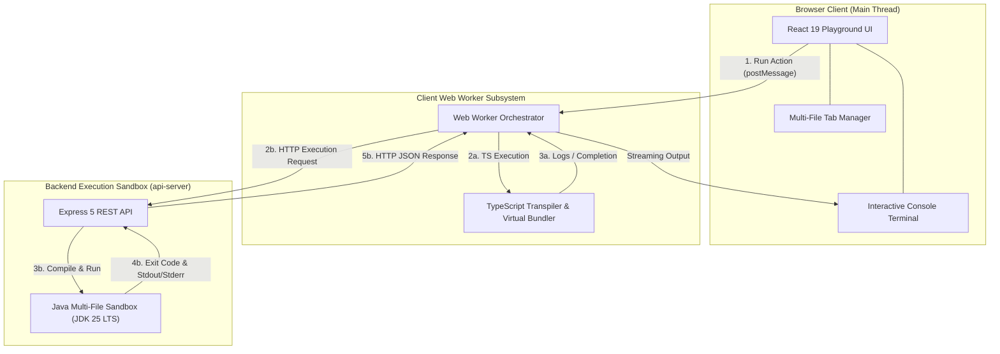

# Product Requirements Document (PRD) & Architecture Specification
## Interactive Multi-File Code Playground Engine (TypeScript & Java)

**Branch**: `feat/code-playground`  
**Status**: **COMPLETED, VERIFIED & PRODUCTION READY**  
**Reference Benchmark**: [OneCompiler (Java & TypeScript)](https://onecompiler.com/java)  
**Target Applications**: `artifacts/pattern-masterclass`, `artifacts/api-server`, `lib/api-spec`

---

## 1. Executive Summary & Problem Statement

### 1.1 The Original Limitation
In earlier builds, the **Code Playground** displayed static code snippets without dynamic execution. Clicking "Run example" evaluated a hardcoded switch statement returning pre-baked strings. If a learner modified code, introduced new classes, or experimented with alternate pattern variations, their changes had no runtime effect. Additionally, the editor was confined to a single monolithic textarea without file tabs, making complex multi-class patterns (such as Abstract Factory, Observer, or Strategy) cramped and non-modular.

### 1.2 Target Vision Achieved
The Code Playground is now a **production-grade, multi-file interactive coding workshop**:
1. **Real Execution Engines**: Real-time compilation and execution for **TypeScript** (browser Web Worker with virtual CommonJS bundler) and **Java** (JDK 25 LTS backend sandbox).
2. **Zero-Freeze Web Worker Isolation**: TypeScript execution runs completely off the main UI thread. Long-running code or runtime exceptions never freeze the browser.
3. **Multi-File Tabbed Workspace**: Users can create, inline-rename, and delete files dynamically in a virtual project tree (e.g. `Main.java`, `GUIFactory.java`, `WinButton.java` or `index.ts`, `strategy.ts`), with protected entry points (`⭐ Entry`).
4. **Interactive Console**: Rich terminal supporting real-time standard output (`stdout`), standard error (`stderr`), compiler diagnostics, duration in milliseconds, and exit status codes.
5. **Strict Single-Scroll UX**: Exactly 1 unified scroll mechanism—eliminating nested double-scrollbar traps.
6. **Dual-Mode Hybrid Viewport**: Seamless toggling between **Stacked Editorial Flow** and **Side-by-Side Resizable Split View** using `react-resizable-panels` with a draggable vertical divider.
7. **Robust Clipboard Suite**: **Copy File** (active tab) vs. **Copy All** (consolidated project with comment headers) with visual feedback.
8. **Consistent Accessible Tooltips**: Standardized with Radix UI `<AppTooltip>` primitives across all editor controls.

---

## 2. System Architecture



---

## 3. UI/UX Layout Specification: Dual-Mode with Draggable Sliding Window

### 3.1 Overview of the Hybrid Architecture
Located in the playground toolbar, users can toggle between two layout modes:
* **Mode A: Stacked Editorial Flow (`Stacked`)**: Full-width editor card that auto-expands with code height, with terminal output card positioned directly below. Pinned to the browser window scrollbar.
* **Mode B: Side-by-Side Resizable Split View (`Split`)**: Left-hand code editor and right-hand interactive terminal separated by a draggable vertical sliding divider (`react-resizable-panels`).

```text
+-----------------------------------------------------------------------------------------------------------------+
| PLAYGROUND TOOLBAR:                                                                                             |
| [Pattern: Abstract Factory v]  [Java | TS]  [▶ Run (Ctrl+Enter)]  [↺ Reset]  |  [ ⬍ Stacked | ⬄ Split ] [Guide F1]    |
+-----------------------------------------------------------------------------------------------------------------+

MODE A: STACKED EDITORIAL FLOW
+-----------------------------------------------------------------------------------------------------------------+
| [⭐ Main.java] [GUIFactory.java ×] [WinButton.java ×] [+ New File]                                              |
| 01 | public class Main {                                                                                        |
| 02 |     public static void main(String[] args) { ... }                                                         |
| 03 | }                                                                                                          |
+-----------------------------------------------------------------------------------------------------------------+
| TERMINAL OUTPUT CARD (Directly below — Full-width logs & stack traces)                                          |
| › Status: Finished in 38ms (Exit 0)                                                                             |
| › [Client] Created WinButton                                                                                    |
+-----------------------------------------------------------------------------------------------------------------+

MODE B: SIDE-BY-SIDE RESIZABLE SPLIT (Sliding Window Handle)
+------------------------------------------------------+||+-------------------------------------------------------+
| [⭐ Main.java] [GUIFactory.java] [+ File]             ||| TERMINAL OUTPUT CONSOLE                               |
| 01 | public class Main {                             ||| › Status: Finished in 42ms (Exit 0)                   |
| 02 |     GUIFactory f = new WinFactory();            |◀▶| › [Client] Created WinButton                         |
| 03 |     Button b = f.createButton();                ||| › Rendering Windows UI elements                       |
| 04 | }                                               |||                                                       |
|                                                      ||| [ Clear ] [ Copy Output ]                             |
+------------------------------------------------------+||+-------------------------------------------------------+
                 Editor Pane (Drag to Resize)           ^              Terminal Pane (Drag to Resize)
                                                  Draggable Handle
```

---

## 4. Multi-File Project Architecture

1. **Protected Entry Points**:
   - `index.ts` (TypeScript) and `Main.java` (Java) are protected against renaming and deletion to guarantee project executability.
2. **Dynamic File Operations**:
   - Add new files via `+ New File` with automatic extension detection and boilerplate scaffolding.
   - Inline rename non-entry tabs via pencil icon or double click.
   - Delete auxiliary tabs via `✕` close button with confirmation prompt.
3. **Execution Consolidation**:
   - TypeScript: Virtual CommonJS module bundle evaluated in-memory.
   - Java: All tabs written to ephemeral temp directory and compiled via `javac -encoding UTF-8 *.java`.

---

## 5. Contract-First API Specification (`lib/api-spec/openapi.yaml`)

```yaml
paths:
  /code/run:
    post:
      operationId: executeCode
      summary: Compile and execute multi-file project code
      requestBody:
        required: true
        content:
          application/json:
            schema:
              type: object
              required: [language, files]
              properties:
                language:
                  type: string
                  enum: [java, typescript]
                files:
                  type: array
                  items:
                    type: object
                    required: [id, name, content]
                    properties:
                      id:
                        type: string
                      name:
                        type: string
                      content:
                        type: string
                      isEntryPoint:
                        type: boolean
      responses:
        "200":
          content:
            application/json:
              schema:
                type: object
                required: [stdout, stderr, exitCode, durationMs]
                properties:
                  stdout:
                    type: array
                    items:
                      type: string
                  stderr:
                    type: array
                    items:
                      type: string
                  exitCode:
                    type: integer
                  durationMs:
                    type: integer
```

---

## 6. Multi-Language Extensibility Roadmap

| Language | Execution Target | Official Runtime Traps & Risks | Architectural Safeguard |
| :--- | :--- | :--- | :--- |
| **Python** | Client WASM (Pyodide Worker) | **Stdout Buffering**: `sys.stdout` is block-buffered when not attached to TTY. | Pass `-u` flag / `PYTHONUNBUFFERED=1`. Client execution via **Pyodide** Web Worker. |
| **Go** | Server Sandbox | **Multi-File Package Scope**: In multi-file Go, all files must share `package main`. | Strategy runner passes directory scope `go run .` within an ephemeral Go module. |
| **Rust** | Server Sandbox | **Crate Root Requirement**: Loose `.rs` files fail without a `main.rs` crate root. | Scaffold lightweight `Cargo.toml` with standard `src/` layout. |
| **C# (.NET)** | Server Sandbox | **Top-Level Statements**: .NET requires a `.csproj` or script file model. | Executes `dotnet run` within ephemeral project sandbox with pre-warmed SDK cache. |
